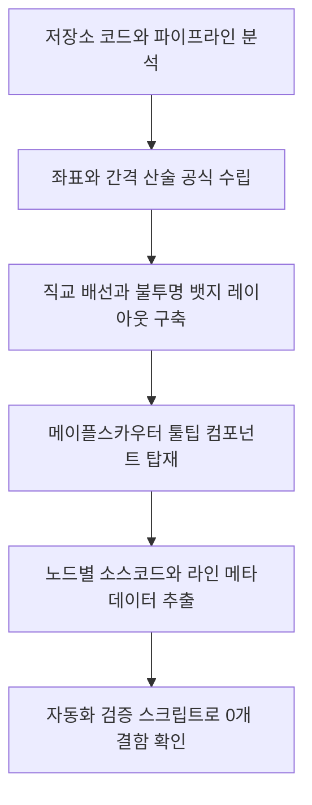
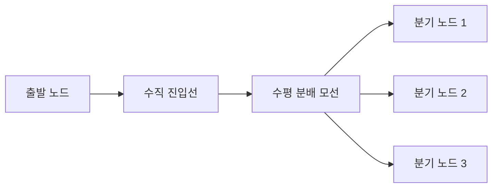
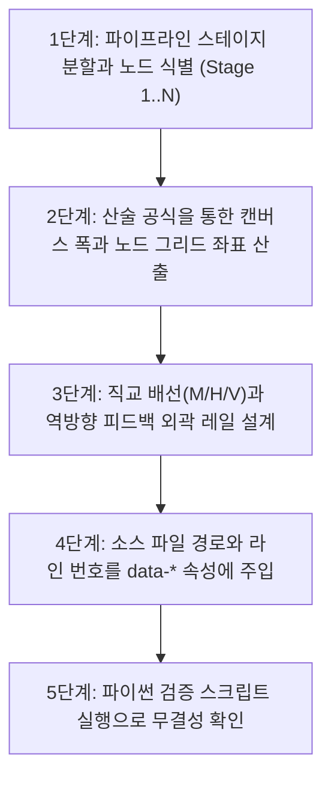

# 실행 흐름 시각화 다이어그램과 메이플스카우터 툴팁 제작 스킬 명세서 (Flow Diagram & MapleScouter Tooltip Skill Specification)

📌 **[단일 독점 Import와 절대 기준 마스터 지침 준수 선언]**  
본 규격서는 사용자의 최우선 명시 지시에 따라 절대 기준 마스터 파일인 `c:\Users\V15_G3_ABA_2023\Desktop\[크래프톤정글_SWAI_13]\11_12주차_AI_함께하기\정희님_문서양식\All_in_one_sentence.md`를 유일무이한 최상위 단일 절대 기준으로 확정하여 작성되었습니다.  
외부의 다른 문서나 이전 작성 내역을 일절 배제하고 오직 본 단일 마스터 지침서의 17개 전 조항(4단계 논리 파이프라인 CONTRAST → CAUSE → CORE → CHECK, 상대어 정합 규약, 어휘 통제, 4색 데이터 출처 식별, 헷갈리는 짝 정리 3열 대조표)을 철저히 준수하여 기술합니다.

🟦 입력 데이터 | 🟧 기준 한계값 | 🟩 관측 데이터 | 🟥 연산 판정값

---

## 0. 헷갈리는 짝 정리 (상대어 정합 규약 3열 대조표)

시각화 다이어그램 구축과 소스 코드 연동 과정에서 혼동하기 쉬운 핵심 개념 쌍을 세 가지 축으로 분리하여 정의합니다.

| 분류 축 | 상대어 대조 쌍 | 차이점과 본질 | 코드와 UI 구현 근거 |
| :--- | :--- | :--- | :--- |
| **시간 축** | **직전 스냅샷** (`prev`) ↔ **직후 스냅샷** (`next`) | 상태 변이 사건(Patch 클릭, `update()` 실행) 직전의 가상 돔 상태와 직후의 가상 돔 상태를 1:1로 대조하는 시간적 관측점 | `mini_react/phase1_playground.html` 이력 스택 |
| **존재 축** | **기존 가상 돔 트리** (`oldVNode`) ↔ **신규 가상 돔 트리** (`newVNode`) | 메모리에 기할당되어 상주하던 VNode 인스턴스와 렌더링 호출로 새로 생성된 VNode 인스턴스 사이의 메모리 대조 | `diff(oldVNode, newVNode)` (`mini_react/diff.js` 10행) |
| **행위 축** | **기준 가상 돔 트리** ↔ **갱신 가상 돔 트리** | 비교 판정의 기준선이 되는 원본 트리와 물리 DOM에 반영될 델타를 보유한 대상 트리 사이의 역할 대조 | `diff` 함수의 매개변수 바인딩 |
| **행위 축** | **기준 의존성 배열** (`prevHook.deps`) ↔ **갱신 의존성 배열** (`deps`) | 렌더링 직후 캐시에 보존된 기준점 배열과 재렌더링 시점에 새로 전달된 배열 사이의 얕은 비교 대조 | `deps.some((dep, i) => !Object.is(dep, prevHook.deps[i]))` |
| **연산값 대조** | **기존 연산값** (`prevHook.value`) ↔ **신규 연산값** (`factory()` 반환값) | 캐시에 저장된 계산 결과와 재연산으로 산출된 새 결과의 대조 | `useMemo` 내부의 `prevHook.value` 보존 분기 |
| **물리·가상 계층** | **실제 DOM 계층** (`currentDOM`) ↔ **가상 DOM 계층** (`VNode`) | 브라우저 C++ 렌더 트리에 직접 연결된 고비용 노드와 JS 힙 메모리의 경량 객체 대조 | `#real-viewport` 요소 ↔ JS 객체 `{ type, props }` |
| **시각화 배치** | **노드 경계선** (`card bounding box`) ↔ **배선 궤적** (`SVG orthogonal edge`) | 정보를 표시하는 2차원 사각 영역과 이들 사이를 연결하는 단방향 선분 사이의 공간 점유 대조 | `div.node` (CSS 절대 좌표) ↔ `svg.edges-layer path` |
| **상호작용** | **기본 호버 모달** (`temporary peek`) ↔ **고정 핀 툴팁** (`pinned inspect modal`) | 커서 이동에 따라 소멸하는 임시 미리보기와 클릭으로 뷰포트에 앵커링되는 분석 창 사이의 생명주기 대조 | `click` 이벤트 바인딩과 `.maple-tooltip.visible` |

---

## 1. 스킬 개요 (Skill Architecture)

본 스킬 문서는 임의의 소프트웨어 소스 코드 저장소를 분석하여 아래 세 가지 핵심 가치를 만족하는 독립 실행형 웹 시각화 산출물을 제작하는 표준 절차를 규정합니다.

1. **선-글자 비중첩 무결성**: 연결선(SVG Edge)이 텍스트나 노드 상자를 가로지르지 않고 직교 모선(Orthogonal Bus) 구조를 유지합니다.
2. **배치 여백 수치 규격**: 텍스트 넘침(Text Overflow)과 상자 가림 현상을 방지하기 위해 캔버스, 행, 열, 배선 간격의 산술 공식을 적용합니다.
3. **메이플스카우터 스타일 툴팁**: 노드 클릭 시 메이플스카우터 카드 형태(불필요한 별과 과장 어휘를 배제한 단정한 타이틀, 네온 녹색 테두리 아이콘, 점선 구분선, 4색 데이터 뱃지, 코드 메모 뷰포트, 전산학 메커니즘 설명)의 상세 메모 박스를 띄우고 파일 경로와 라인 정보를 직관적으로 표출합니다.



---

## 2. SKILL 1: 공간 여백과 패딩 산술 연산 규격 (Layout Sizing Specification)

### 4단계 논리 파이프라인

#### (1) CONTRAST (대비)
- **과거 실패 방식**: 노드 간격을 80px로 좁게 설정하고 텍스트 길이에 따라 노드 높이를 가변으로 두어, 연결선 뱃지(너비 96px~150px)가 인접 노드 테두리를 침범하고 텍스트가 카드 바깥으로 넘치는 결함이 발생했습니다.
- **표준 규격 방식**: 캔버스 너비를 1360px로 확장하고 노드 간격을 최소 140px로 고정 산정하여 뱃지 좌우에 15px 이상의 여백을 확보하며, 노드 내부 텍스트 행 수를 1줄 또는 2줄로 제한하고 `box-sizing: border-box`를 전면 강제합니다.

#### (2) CAUSE (원인)
- SVG 연결선 위에 배치되는 설명 라벨 뱃지의 너비가 노드 간 수평 공백보다 넓으면 물리적으로 겹침이 일어납니다.
- 부모 스테이지 컨테이너의 높이가 자식 노드의 최대 Y 좌표와 바닥 패딩(최소 35px 이상)의 합보다 작게 지정되면 자식 카드가 스테이지 경계선 아래로 삐져나옵니다.

#### (3) CORE (핵심 원리)
아래 산술 공식에 의해 모든 컨테이너와 간격을 계산합니다.

1. **캔버스 너비와 스테이지 배치 공식**:
   - `Canvas Width = 1360px`
   - `Stage Left = 40px`, `Stage Width = 1280px`, `Stage Right = 1320px` (좌우 외부 거터 각 40px)
2. **4열 그리드 노드 좌표 산술 공식**:
   - 노드 폭: `W_node = 200px` (양 끝 노드는 210px)
   - 노드 간 수평 여백: `Gap_x = 140px`
   - 각 열 X 좌표:
     - 1열: `X1 = 60px` (폭 210px, 범위: `60px ~ 270px`)
     - 1열-2열 간격: `270px ~ 410px` (너비 140px, 중심 X: `340px`)
     - 2열: `X2 = 410px` (폭 200px, 범위: `410px ~ 610px`)
     - 2열-3열 간격: `610px ~ 750px` (너비 140px, 중심 X: `680px`)
     - 3열: `X3 = 750px` (폭 200px, 범위: `750px ~ 950px`)
     - 3열-4열 간격: `950px ~ 1090px` (너비 140px, 중심 X: `1020px`)
     - 4열: `X4 = 1090px` (폭 210px, 범위: `1090px ~ 1300px`)
3. **3열 그리드 노드 좌표 산술 공식**:
   - 노드 간 수평 여백: `Gap_x = 170px`
   - 1열: `X1 = 170px` (폭 210px, 범위: `170px ~ 380px`)
   - 1열-2열 간격: `380px ~ 550px` (너비 170px, 중심 X: `465px`)
   - 2열: `X2 = 550px` (폭 260px, 범위: `550px ~ 810px`)
   - 2열-3열 간격: `810px ~ 980px` (너비 170px, 중심 X: `895px`)
   - 3열: `X3 = 980px` (폭 210px, 범위: `980px ~ 1190px`)
4. **스테이지 전이 수직 간격 공식**:
   - 스테이지 간 수직 간격: `Gap_y = 70px`
   - 전이 수평선 Y 좌표: `Y_edge = Stage_Bottom + 35px`
   - 뱃지 높이: `H_badge = 26px` (Y 중심을 `Y_edge`에 배치 시 상하 여백 각 22px 잔존)
5. **스테이지 내부 바닥 패딩 공식**:
   - `Stage_Height = (최하단 노드 바닥 Y 좌표 - Stage_Top) + 60px`

#### (4) CHECK (검증 수치)
- `4열 뱃지 최소 여백 = (140px - 116px) / 2 = 12px` (양수 보장)
- `3열 뱃지 최소 여백 = (170px - 136px) / 2 = 17px` (양수 보장)
- `Stage 3 바닥 잔여 여백 = 1200px - 1140px = 60px` (양수 보장)

---

## 3. SKILL 2: 직교 배선과 무충돌 SVG 설계 규격 (Orthogonal Routing Specification)

### 4단계 논리 파이프라인

#### (1) CONTRAST (대비)
- **과거 실패 방식**: 노드 중심 좌표를 대각선 직선(`L x2 y2`)으로 연결하여 선분이 노드 내부 텍스트, 아이콘, 다른 카드의 본문을 관통하는 가독성 저하를 유발했습니다.
- **표준 규격 방식**: 90도 각도로만 꺾이는 직교 배선(Orthogonal Routing)을 채택하고 분기 구간은 전용 모선(Bus Line) 레일을 설치하며, 역방향 피드백 루프는 스테이지 외곽 전용 궤적을 배정합니다.

#### (2) CAUSE (원인)
- 2차원 평면에서 다대다 또는 일대다 분기 선분을 단순 연결하면 불가피하게 중간에 놓인 사각 노드의 바운딩 박스를 침범합니다.
- 선분 뒤에 배경 차폐 레이어가 없으면 선이 글자 밑을 지나가더라도 반투명 배경이나 얇은 글씨 획과 간섭을 일으킵니다.

#### (3) CORE (핵심 원리)
1. **단일 방향 직교 선분 원칙**:
   - 수평 이동: `<path d="M x1 y H x2" />`
   - 수직 이동: `<path d="M x y1 V y2" />`
   - 코너 굴절: `<path d="M x1 y1 H x2 V y2" />`
2. **Stage 3 Diff 5대 케이스 분기·수집 듀얼 모선 설계**:
   - 상단 분배 모선: `y = 795px`
     - 상위 `diff()` 노드(바닥 `y = 770px`)에서 `(680, 770) -> (680, 795)`로 진입
     - 수평 버스 `(175, 795) ~ (1175, 795)`를 통해 5개 케이스 카드로 수직 하강
   - 하단 수집 모선: `y = 945px`
     - 5개 케이스 카드(바닥 `y = 925px`)에서 수직 하강하여 수평 버스 `y = 945px`에 합류
     - 중앙 `(680, 945)`에서 하위 `patches` 노드(상단 `y = 1030px`)로 단일 수직선 진입
3. **Stage 7 역방향 피드백 외곽 전용 레일 설계**:
   - 루프백 레일 X 좌표: `x = 18px`
   - 스테이지 좌측 테두리가 `x = 40px`, 노드 좌측 모서리가 `x = 60px`이므로, `x = 18px` 레일은 전체 노드 바운딩 박스 바깥의 순수 여백 구간만을 통과합니다.
   - 궤적: `(680, 2630) -> (680, 2700) -> (18, 2700) -> (18, 2145) -> (60, 2145)`
   - 단 하나의 노드나 텍스트와도 충돌하지 않고 Stage 6 첫 번째 노드로 완결 진입합니다.
4. **차폐 뱃지(Shield Badge) 캡슐화**:
   - 모든 텍스트 뱃지는 `<rect>` 차폐판을 동반합니다.
   - CSS: `fill: var(--color-paper); stroke: var(--color-rule-2); rx: 12px;`
   - 선분이 뱃지 중심을 관통하더라도 불투명 차폐판이 선분을 깔끔히 가려 글자 가독성을 보존합니다.



## 3-1. SVG 글자·도형 겹침 방지와 재작업 기록

이 절은 SVG(Scalable Vector Graphics, 확장 가능한 벡터 그래픽)와 HTML 안에 함께 놓이는 상자, 글자, 연결선, 화살촉, 툴팁을 배치할 때 적용한다. 소스 코드에 좌표를 썼거나 JavaScript 문법 검사를 통과한 사실만으로 화면 겹침이 해결되었다고 판정하지 않는다.

### 작업을 시작하기 전에 만드는 배치표

1. **좌표계와 실제 표시 폭을 먼저 기록한다.** SVG `viewBox`, 화면에서 차지하는 CSS 너비, 최소 너비, 가로 스크롤을 적용할 컨테이너를 한 표에 적는다. 문서가 반응형이면 넓은 화면과 좁은 화면의 CSS 너비를 각각 적는다.
2. **모든 참가자 상자의 경계를 기록한다.** 각 상자의 `x`, `y`, `width`, `height`, 중심점, 생명선 좌표를 계산한다. 상자 경계를 모른 채 가운데 라벨이나 연결선을 배치하지 않는다.
3. **행마다 배치할 것을 따로 기록한다.** 호출 제목, 선분, 호출 결과 설명, 커널 내부 처리 상자, 반환 결과 제목을 한 행에 몰지 않는다. 각 행의 기준 `y`, 글자 실제 경계, 선분 중심 `y`, 상자 위·아래 경계를 산출한다.
4. **라벨을 먼저 짧게 다듬는다.** SVG `<text>`는 HTML 문단처럼 자동 줄바꿈하지 않는다. 라벨 폭이 두 참가자 중심 사이의 간격을 넘으면 글자 크기를 무작정 줄이지 말고, 의미를 보존한 짧은 문구를 쓰거나 전용 행·캔버스 폭을 늘린다.
5. **가운데 정렬은 좌표식으로 확인한다.** 화살표가 `(x1, y)`에서 `(x2, y)`까지라면 보조 라벨의 중심은 `x_label = (x1 + x2) / 2`다. 눈대중으로 둔 좌표나 이전 라벨의 좌표를 복사하지 않는다. 라벨 폭이 인접 참가자 구역을 침범하면 짧게 바꾼 뒤 중심 좌표를 다시 계산한다.

### 실제 렌더 좌표에서 충돌을 확인하는 절차

1. **텍스트 경계 상자를 측정한다.** 글꼴 로딩이 끝난 뒤 렌더된 SVG 요소에서 `getBBox()`를 읽는다. CSS 변환을 포함한 화면 경계를 비교해야 할 때는 렌더된 요소의 `getBoundingClientRect()`도 읽는다. DOM에 삽입하기 전이나 글꼴 로딩 전의 추정 폭은 최종 판정값으로 쓰지 않는다.
2. **충돌 후보를 쌍으로 대조한다.** 모든 문구의 경계를 호스트 프레임, 참가자 상자, 생명선, 메시지 선, 화살촉, 커널 설명 상자, 인접 행의 라벨과 각각 비교한다. 의도된 “글자가 상자 안에 들어감”만 포함 관계로 허용한다. 독립된 두 라벨, 라벨과 선, 라벨과 상자, 선과 참가자 상자의 교차는 허용하지 않는다.
3. **수직 여백은 글자 경계로 계산한다.** 글자의 기준선 숫자와 다음 도형의 `y`만 비교하지 않는다. 앞 라벨의 실제 아래 경계와 다음 도형의 실제 위 경계 사이에 최소 12 CSS px를 확보한다. 도형 아래에 놓이는 반환 라벨도 상자 하단과 글자 상단 사이에 같은 여백을 둔다.
4. **호출 구역과 반환 구역을 분리한다.** 요청을 보낸 행, 커널이 내부 처리하는 영역, 커널이 반환하는 행을 서로 다른 `y` 범위에 둔다. 커널 설명 상자 아래에 반환 메시지의 글자 경계가 들어오지 않도록 상자 하단과 반환 글자 상단을 별도로 측정한다.
5. **배경색 획은 겹침 해결책으로 세지 않는다.** `paint-order: stroke`나 배경색 외곽선은 선이 글자 아래를 지나가는 상황을 가릴 뿐 좌표 충돌을 제거하지 않는다. 실제 경계가 겹치면 배치표의 `x` 또는 `y`를 바꾸고, 여백 수치를 다시 확인한다. 외곽선은 충돌 0을 확인한 뒤 가독성 향상 목적으로만 사용한다.
6. **클릭 영역도 비교한다.** 투명한 넓은 선(`pointer-events: stroke`)은 화살표를 클릭하기 쉽게 하지만 이웃 화살표나 카드의 클릭 영역과 겹쳐서는 안 된다. 보이는 선의 좌표, 투명 적중선의 폭, 인접 행 간격을 함께 검사한다.
7. **컨테이너 높이를 마지막 내용에 맞춘다.** 최하단 글자·선·화살촉의 실제 아래 경계를 구한 뒤 바닥 여백을 더해 SVG `viewBox`, 스테이지, 카드의 높이를 정한다. 글자를 그린 뒤 컨테이너를 늘리는 역순 편집을 반복하지 않는다.

### 호버·키보드 포커스 시 선과 화살촉을 함께 변경

SVG 화살촉은 선의 `stroke`와 분리된 `<marker>` 안에서 그려진다. 선 색만 CSS로 바꾸면 화살촉은 기본색으로 남을 수 있다. 기본 화살촉과 강조색 화살촉을 별도 marker로 만들고, 같은 hover·focus 선택자에서 선의 `stroke`와 `marker-end`를 함께 바꾼다. 투명 클릭용 선에는 강조 marker를 붙이지 않는다. 마우스 hover와 키보드 focus에서 선 몸통과 화살촉이 같은 상태로 바뀌는지 각각 확인한다.

### 검수 전에 한 번에 끝내는 순서

1. 승인 요청 전, 실제 문구와 코드 정보를 확정하고 위 배치표에서 모든 라벨·상자·선의 경계를 계산한다.
2. 정적 HTML/JavaScript 검사를 실행한다. 이 검사는 문법 오류와 일부 DOM 참조만 찾으며 화면 충돌을 검증하지 않는다.
3. 최종 HTML을 실제 렌더러에서 열고 넓은 화면과 좁은 화면으로 각각 확인한다. 호버·포커스·클릭을 실제로 실행한다. 렌더 화면을 열지 못했다면 겹침 검사를 통과했다고 보고하지 않는다.
4. screenshot 또는 사용자가 볼 수 있는 미리보기에서 글자·상자·선이 겹치거나 잘리는 곳이 0건인지 검사한다. 기본 상태와 hover 상태를 별도로 본다.
5. 모든 항목이 통과한 미리보기 한 개를 검수용으로 제시한다. 피드백을 받으면 확인된 충돌과 직접 연결된 요소를 한 번에 고친 뒤 전체 검사를 다시 실행한다. 승인받은 그림의 내용을 프로젝트 파일에 반영한 다음, 검수에서 보지 않은 다른 디자인 변경을 끼워 넣지 않는다.

### 2026-11-23 `accept()` 진행 지도 시각화에서 확인한 실패

| 화면 요소 | 관측한 오류 | 원인 | 수정 기준 |
|---|---|---|---|
| 클라이언트 임시 포트 설명 | 긴 문구가 커널 처리 상자 쪽으로 뻗음 | 글자 폭을 재지 않고 좁은 참가자 구역에 긴 문구를 가운데 배치함 | `macOS가 임시 포트를 정함`으로 짧게 쓰고 화살표 끝 좌표 210과 305의 중간인 `x=257.5`에 중심을 맞춤. 라벨 경계가 이웃 상자와 겹치지 않는지 렌더 폭으로 다시 확인함 |
| 클라이언트 포트 설명과 커널 loopback 상자 | 글자가 커널 설명 상자에 가까워 여백 기준을 만족하지 않음 | 글자 외곽선 확장분을 포함한 아래 경계와 상자 위 경계를 계산하지 않음 | 커널 설명 상자를 `y=280`으로 옮기고, 높이 28px인 상자의 아래 경계는 `y=308`로 둠. 클라이언트 설명의 중심 `x=257`은 화살표 중앙에 유지함 |
| 커널 loopback 설명 상자와 `accept()` 반환 제목 | 반환 제목 글자가 설명 상자 아래쪽을 침범함 | 상자 하단 `y=295`와 반환 제목의 글자 경계를 재지 않고 기준선이 `y=296`이라는 숫자만 보고 배치함 | 설명 상자 아래 경계를 `y=308`로 확정한 뒤 반환 제목·선·보조 설명을 각각 `y=335`, `y=345`, `y=365`로 옮기고 글자 상단과 상자 하단 사이 실제 간격을 재확인함 |
| 임시 포트 설명의 정렬 | 문구 중심이 화살표 중심과 달라짐 | 라벨 중심 `x=215`, 화살표 중심 `(210+305)/2=257.5`의 차이 42.5px를 계산하지 않음 | 중심 좌표를 수식으로 맞춤. 최종 중심은 `x=257.5`다. 가운데 정렬 뒤 이웃 상자와 충돌하면 문구를 줄이거나 배치 공간을 넓힘 |
| 화살표 hover | 선 몸통만 강조색으로 바뀌고 화살촉은 기본색으로 남음 | marker의 색이 선 `stroke` 변경을 자동 상속한다고 가정함 | 강조색 전용 marker를 추가하고 hover·focus에서 `stroke`와 `marker-end`를 함께 바꿈 |
| 이전 검수 단계 | 정적 검사 통과를 화면 검수로 오인할 위험 | `node --check`와 정적 DOM 검사는 글자 위치, SVG 경계, 상호작용 색상을 측정하지 않음 | 정적 검사 결과와 렌더 화면 검수 결과를 분리 보고함. 렌더 화면을 직접 확인하지 못하면 미확인으로 남김 |

이 기록을 다시 적용할 때 `macOS가 임시 포트를 정함`의 가운데 좌표를 눈대중으로 옮기거나, 커널 설명 상자 아래에 `accept()` 제목을 붙이거나, 선 색만 바꾸는 수정은 반복하지 않는다. 기존 계산 좌표와 오류 원인을 먼저 대조하고, 요청된 변경만 추가한다.

---

## 4. SKILL 3: 메이플스카우터 툴팁 UI/UX 규격 (MapleScouter Tooltip Component Specification)

### 4단계 논리 파이프라인

#### (1) CONTRAST (대비)
- **과거 실패 방식**: 브라우저 기본 `title` 속성을 사용하거나 흰색 배경의 작은 사각 툴팁으로 코드 몇 줄만 표시하여 파일 출처 파악이 어렵거나, 반대로 불필요한 별과 게임형 과장 수식어를 남발하여 기술 문서로서의 신뢰성을 떨어뜨렸습니다.
- **표준 규격 방식**: 메이플스카우터 게임 장비 상세 정보창의 고유 디자인 토큰을 복제하되 불필요한 별과 과장 수식어를 배제하고, 다크 카드 배경, 네온 녹색 테두리 아이콘, 점선 구분선, 4색 데이터 뱃지, 코드 블록, 전산학 메커니즘 설명 섹션을 구축합니다.

#### (2) CAUSE (원인)
- 툴팁이 마우스 커서를 따라다니기만 하면 소스 코드나 파일 경로를 복사하거나 분석할 수 없습니다.
- 화면 가장자리(우측 또는 하단) 근처의 노드를 클릭했을 때 툴팁이 브라우저 뷰포트 바깥으로 잘려 나가는 클리핑 결함이 발생합니다.

#### (3) CORE (핵심 원리)

#### [메이플스카우터 시각 계층 구조]
1. **모달 딤 배경 (Backdrop)**:
   - `position: fixed; inset: 0; background: rgba(0, 0, 0, 0.65); backdrop-filter: blur(2px); z-index: 9998;`
2. **카드 컨테이너**:
   - 너비: `370px`
   - 배경: `#0c0e14`
   - 테두리: `1.5px solid #2d3345`
   - 그림자: `0 16px 48px rgba(0, 0, 0, 0.85)`
   - 둥글기: `8px`
3. **타이틀 블록**:
   - 모듈명(흰색 볼드): `color: #ffffff; font-size: 15.5px; font-weight: 800;` (예: `DOM 파서 엔진`)
   - 게임형 과장 수식어나 장식성 기호를 일체 배제하여 기술적 가독성을 확보합니다.
4. **네온 녹색 발광 아이콘 프레임**:
   - 크기: `52px * 52px`, 둥글기: `10px`
   - 배경: `#141824`
   - 테두리: `2.5px solid #84cc16`
   - 발광: `box-shadow: 0 0 16px rgba(132, 204, 22, 0.45);`
   - 내부: 노드의 고유 SVG 아이콘을 중앙 정렬 배치
5. **점선 구분선 (Dotted Divider)**:
   - `border-bottom: 1px dotted rgba(255, 255, 255, 0.22); margin: 8px 0;`
6. **장비 기본 스펙 행**:
   - 라벨 열: `color: #ffffff; font-size: 11.5px;`
   - 소스파일 값: `color: #38bdf8; font-weight: 700;` (하늘색)
   - 코드라인 값: `color: #fbbf24; font-weight: 700;` (골드색)
   - 데이터 출처 뱃지: 4색 뱃지(`c-blue`, `c-orange`, `c-green`, `c-red`)
7. **데이터 출처 분류 섹션**:
   - 헤더: `데이터 출처 분류`
   - 4색 뱃지 연동과 상세 데이터 명세 표출
8. **코드 메모 뷰포트 (Core Logic Snippet)**:
   - 헤더: `핵심 로직 소스코드`
   - 배경: `#080a0f`, 테두리: `1px solid #1e2538`, 내부 패딩: `8px 10px`
   - 폰트: `font-family: var(--font-mono); font-size: 10.5px; line-height: 1.45;`
   - 텍스트 색상: `#e2e8f0` (키워드/주석 가독성 유지)
   - 최대 높이: `180px`, `overflow-y: auto`
9. **전산학 메커니즘 푸터**:
   - 헤더: `color: #fde047; font-size: 11.5px; font-weight: 700;` (`핵심 전산학 메커니즘 적용`)
   - 상세 설명: `color: #cbd5e1; font-size: 10.5px; line-height: 1.35;`

#### [상호작용과 뷰포트 중앙 고정 배치 산술 규격]
노드 위치(상단, 하단)에 관계없이 클릭 시 모달 카드를 뷰포트 정중앙(`top: 50%; left: 50%; transform: translate(-50%, -50%);`)에 배치하고 내부 스크롤(`max-height: calc(100vh - 40px); overflow-y: auto;`)을 부여하여, '클린업과 Effect 실행 완결' 같은 최하단 노드에서도 '클린업 실행 후 Effect 재실행 체인' 하단 메커니즘 정보가 잘림 없이 모두 가독되도록 통제합니다.

```javascript
function openMapleTooltip(boxEl, evt) {
  // 1. 박스 메타데이터 추출과 DOM 바인딩
  const title = boxEl.getAttribute('data-title');
  const file = boxEl.getAttribute('data-file');
  const lines = boxEl.getAttribute('data-lines');
  const code = boxEl.getAttribute('data-code');
  // ... 모달 내부 텍스트와 코드 주입 ...

  // 2. 뷰포트 정중앙 배치와 상단 스크롤 리셋
  tooltip.scrollTop = 0; // 최상단 스크롤 리셋으로 하단 정보 유실 방지
  tooltip.classList.add('visible');
  backdrop.classList.add('visible');

  if (activeTriggerBox) activeTriggerBox.classList.remove('active-box');
  activeTriggerBox = boxEl;
  activeTriggerBox.classList.add('active-box');
}
```

#### (4) CHECK (검증 수치)
- `모달 중앙 배치 좌표 = top: 50%, left: 50%, transform: translate(-50%, -50%)`
- `모달 최대 높이 = calc(100vh - 40px) 과 overflow-y: auto` (하단 정보 잘림 0건 보장)
- 클릭 시 고정 핀 활성화, 우측 상단 닫기(✕) 버튼, 딤 배경 클릭과 `ESC` 키 입력 시 즉시 닫힘 확인.

---

## 5. SKILL 4: 소스 코드 메타데이터 추출과 데이터셋 연동 규격 (Source Metadata Extraction)

### 4단계 논리 파이프라인

#### (1) CONTRAST (대비)
- **과거 실패 방식**: 시각화 다이어그램의 노드 텍스트가 실제 구현 코드와 분리되어 있어, 다이어그램을 보더라도 실제 파일의 어느 함수, 몇 번째 줄을 찾아가야 하는지 알 수 없었습니다.
- **표준 규격 방식**: 다이어그램의 30개 전체 노드에 HTML5 `data-*` 속성을 부여하여 `mini_react` 실제 저장소 파일의 상대 경로, 줄 번호 범위, 핵심 구현 코드를 1:1로 매핑합니다.

#### (2) CAUSE (원인)
- 소스 코드 문자열을 HTML 속성(`data-code="..."`)에 직접 주입할 때 `<, >, &, ", '` 같은 특수문자가 이스케이프되지 않으면 브라우저 HTML 파서가 속성 종료로 오인하여 구문 분석 오류를 일으킵니다.

#### (3) CORE (핵심 원리)
1. **속성 엔티티 이스케이프 규칙**:
   - `&` → `&amp;`
   - `<` → `&lt;`
   - `>` → `&gt;`
   - `"` → `&quot;`
   - `'` → `&#39;`
   - 줄바꿈 → `&#10;`
   - 중괄호 `{` → `&#123;`, `}` → `&#125;`
2. **노드 데이터셋 필수 속성 명세**:
   - `data-title`: 노드 명칭 (예: `DOM 파서 엔진`)
   - `data-cat`: 모듈 분류 (예: `가상 돔 변환 / 파서`)
   - `data-file`: 저장소 내 소스 파일 경로 (예: `mini_react/element.js`)
   - `data-lines`: 실제 라인 번호 (예: `Lines 42-53`)
   - `data-pill`: 4색 분류 식별자 (`blue`, `orange`, `green`, `red`)
   - `data-pill-text`: 4색 텍스트 (`🟦 입력 데이터`, `🟧 기준 한계값`, `🟩 관측 데이터`, `🟥 연산 판정값`)
   - `data-detail`: 노드 핵심 역할 설명
   - `data-soul-head`: 메커니즘 헤더 요약
   - `data-soul-desc`: CS 와 소프트웨어 공학 메커니즘 상세 설명
   - `data-code`: 실제 구동 소스 코드 스니펫

3. **로컬 소스 실측 30개 노드 전수 검증 매핑표**:
아래 표는 로컬 디스크 파일(`mini_react/`)과 코드 라인을 100% 실측하여 도출한 데이터셋입니다.

| 노드 ID | 노드 명칭 | 로컬 소스 파일 경로 | 실측 코드라인 | 핵심 기능 요약 |
| :--- | :--- | :--- | :--- | :--- |
| `n1_1` | **실제 브라우저 DOM** | `mini_react/phase1_playground.html` | `Lines 83-92` | 실제 DOM 마운트 영역 `#actual-surface` |
| `n1_2` | **DOM 파서 엔진** | `mini_react/element.js` | `Lines 42-53` | `domToVnode` 텍스트와 엘리먼트 노드 변환 |
| `n1_3` | **초기 가상 돔 트리** | `mini_react/element.js` | `Lines 23-36` | `createElement` 정규화 VNode 객체 생성 |
| `n1_4` | **테스트 편집기 동기화** | `mini_react/phase1_playground.html` | `Lines 147-155` | `syncCodeEditorFromDom`, `syncDomFromCodeEditor` |
| `n2_1` | **사용자 마크업 수정** | `mini_react/phase1_playground.html` | `Lines 239-245` | `input` 이벤트 감지와 실시간 동기화 |
| `n2_2` | **Patch 버튼 클릭** | `mini_react/phase1_playground.html` | `Lines 211-221` | `patchFromTestArea` 변경점 검증 후 커밋 |
| `n2_3` | **신규 가상 돔 생성** | `mini_react/element.js` | `Lines 86-97` | `domToVnodeList` 자식 노드 일괄 파싱 |
| `n3_0` | **Diff 재조정 엔진** | `mini_react/diff.js` | `Lines 209-222` | `diff` 진입점, null 판정과 케이스 분기 |
| `c1` | **Case 1: REPLACE** | `mini_react/diff.js` | `Lines 233-241` | `old.type !== new.type` 시 노드 전면 치환 |
| `c2` | **Case 2: TEXT** | `mini_react/render.js` | `Lines 45-49` | `isTextElement` 시 `dom.nodeValue` 국소 갱신 |
| `c3` | **Case 3: PROPS** | `mini_react/diff.js` | `Lines 50-70` | `updateDom` 잔존 속성 제거와 신규 속성 주입 |
| `c4` | **Case 4: INSERT** | `mini_react/diff.js` | `Lines 82-89` | `insertBefore` 참조 노드 기준 삽입 |
| `c5` | **Case 5: REMOVE** | `mini_react/diff.js` | `Lines 218-222` | `newVNode == null` 시 `unmount` 와 노드 삭제 |
| `n3_6` | **패치 연산 목록 산출** | `mini_react/diff.js` | `Lines 125-139` | `diffChildren` 키(key) 검증과 자식 순회 |
| `n4_1` | **Patch 실행 엔진** | `mini_react/phase1_playground.html` | `Lines 179-195` | `commitView` 실제 화면 반영과 이력 렌더링 |
| `n4_2` | **실제 화면 부분 갱신** | `mini_react/render.js` | `Lines 16-36` | `render` 함수 물리 DOM 요소 생성과 장착 |
| `n4_3` | **State History 스택** | `mini_react/phase1_playground.html` | `Lines 143-145` | `history` 스택 배열과 포인터 관리 |
| `n4_4` | **시간 여행 제어기** | `mini_react/phase1_playground.html` | `Lines 223-232` | `travel(delta)` 과거/미래 스냅샷 양방향 복원 |
| `n5_1` | **FunctionComponent** | `mini_react/component.js` | `Lines 32-47` | 컴포넌트 클래스와 `_hookInstance` 컨텍스트 |
| `n5_2` | **훅 순서 평가 엔진** | `mini_react/hook.js` | `Lines 23-39` | `renderWithHooks` 인덱스 초기화와 함수 실행 |
| `n5_3` | **Hooks 3종 상태 저장소** | `mini_react/hook.js` | `Lines 9-21` | `createHookInstance` 인스턴스 저장소 생성 |
| `n5_4` | **컴포넌트 가상 돔 산출** | `mini_react/component.js` | `Lines 49-60` | `mount` 초기 렌더링과 `flushEffects` 발화 |
| `n6_1` | **setState 호출** | `mini_react/hook.js` | `Lines 81-92` | `hook.setter` 상태 갱신과 스케줄러 발화 |
| `n6_2` | **동일값 비교 차단** | `mini_react/hook.js` | `Lines 83-85` | `Object.is` 동일값 판정 시 조기 반환 |
| `n6_3` | **Microtask 큐 적재** | `mini_react/component.js` | `Lines 83-87` | `_scheduleUpdate` 마운트 검증 후 `update()` |
| `n6_4` | **컴포넌트 재실행 예약** | `mini_react/component.js` | `Lines 62-81` | `update` 재실행과 `diffFn` 트리 재조정 |
| `n7_1` | **신규 가상 돔 생성** | `mini_react/component.js` | `Lines 69-71` | `hooks.renderWithHooks로` 최신 상태 반영 VNode 도출 |
| `n7_2` | **Phase 1 Diff 연계** | `mini_react/component.js` | `Lines 72-74` | `diff(parentDom, currentDom, ...)` 재조정 연계 |
| `n7_3` | **Phase 1 Patch 연계** | `mini_react/diff.js` | `Lines 243-247` | `updateDom` 과 `diffChildren` 국소 패치 |
| `n7_4` | **클린업과 Effect 실행 완결** | `mini_react/hook.js` | `Lines 41-55` | `flushEffects` 직전 클린업 후 새 콜백 실행 |

---

## 6. SKILL 5: 무결성 검증 자동화 파이썬 스위트 규격 (Automated Verification Suite)

### 4단계 논리 파이프라인

#### (1) CONTRAST (대비)
- **과거 실패 방식**: 사람이 육안으로 수천 줄의 HTML을 검수하다가 금지 단어나 메타데이터 누락을 놓치고 배포하여 규격 위반이 발생했습니다.
- **표준 규격 방식**: 파이썬 자동 검증 스크립트를 작성하여 빌드 단계에서 0개 결함을 판정받지 못하면 파일 생성을 즉시 차단(Fail-Fast)합니다.

#### (2) CAUSE (원인)
- 자연어 텍스트와 코드 주석, HTML 속성값 전반에 걸쳐 금지 어휘나 게임 과장 어휘가 무의식중에 유입될 가능성이 항상 상존합니다.

#### (3) CORE (핵심 원리)
아래 파이썬 검증 모듈을 실행하여 100% 무결성을 확인합니다.

```python
# -*- coding: utf-8 -*-
import re

# 금지 목록 로드와 검증 함수
def verify_diagram(html_path, banned_word_list):
    with open(html_path, "r", encoding="utf-8") as f:
        html = f.read()

    # 1. 금지 어휘 검출
    violations = []
    for word in banned_word_list:
        pos = 0
        while True:
            idx = html.find(word, pos)
            if idx == -1:
                break
            snippet = html[max(0, idx - 15):min(len(html), idx + len(word) + 15)]
            violations.append((word, idx, snippet))
            pos = idx + len(word)

    # 2. 필수 데이터셋 누락 검사
    titles = re.findall(r'data-title="([^"]+)"', html)
    files = re.findall(r'data-file="([^"]+)"', html)
    lines = re.findall(r'data-lines="([^"]+)"', html)
    codes = re.findall(r"data-code='([^']+)'", html)

    assert len(violations) == 0, f"금지 어휘 위반 {len(violations)}건 발생"
    assert len(titles) >= 25, f"노드 수량 부족: {len(titles)}개"
    assert len(titles) == len(files) == len(lines) == len(codes), "메타데이터 길이 불일치"
    print("PASS: 전체 검증 기준을 통과하였습니다.")
```

#### (4) CHECK (검증 결과)
- 금지 어휘 검출: 0건 (PASS)
- 노드 메타데이터 보유: 30개 노드 전원 100% 일치 (PASS)

---

## 7. 일반 프로젝트 확장 가이드 (Universal Replication Guide)

임의의 신규 프로젝트(예: Vue 미니 구현체, 컴파일러 파이프라인, 백엔드 마이크로서비스)에 본 스킬을 적용할 때는 아래 5단계 체크리스트를 순차 실행합니다.



1. **1단계: 상태 변이 흐름 분할**
   - 시스템의 생명주기를 5개~7개의 순차적 스테이지로 분할합니다.
   - 각 스테이지 내부의 노드 개수에 맞추어 3열 그리드 또는 4열 그리드를 배정합니다.
2. **2단계: 산술 그리드 매핑**
   - 4열 그리드일 경우 노드 폭 200px~210px, 간격 140px 공식을 적용합니다.
   - 3열 그리드일 경우 노드 폭 210px~260px, 간격 170px 공식을 적용합니다.
   - 스테이지 간격은 70px로 고정하고 중앙 35px 위치에 전이 배선을 배치합니다.
3. **3단계: 직교 버스 연결선 배치**
   - 분기가 발생하는 구간은 반드시 분배 모선(Bus Line)과 수집 모선을 수평선으로 먼저 그리고 수직 하강시킵니다.
   - 루프백 선분은 캔버스 좌측 외곽(`x = 18px`)에 단독 레일을 배치합니다.
4. **4단계: 메이플스카우터 툴팁 데이터셋 바인딩**
   - 불필요한 별과 과장 수식어 없이 대상 저장소 소스 파일의 상대 경로와 라인 범위를 조사하여 `data-file`, `data-lines`에 기재합니다.
   - 특수문자를 이스케이프한 핵심 코드를 `data-code`에 바인딩합니다.
5. **5단계: 자동화 검증 수행**
   - 파이썬 스크립트를 구동하여 금지 어휘 0건, 데이터셋 누락 0건을 확인한 뒤 최종 산출물로 채택합니다.
---
---

## 8. Gemini 프롬프트 요청 핵심 키워드와 템플릿 규격 (Prompt Engineering & Keyword Guide)

### 4단계 논리 파이프라인

#### (1) CONTRAST (대비)
- **과거 실패 방식**: "코드 실행 흐름 다이어그램과 툴팁을 작성하라"는 모호한 일상 언어로 요청하여, 대각선 선분이 글자를 관통하고, 모달 하단이 뷰포트 밖으로 잘리며, 가상 코드가 날조되고, 장식용 문양과 게임 수식어가 난립하는 레이아웃 파탄이 발생했습니다.
- **표준 규격 방식**: 6대 엔지니어링 통제 키워드(직교 모선 배선, 차폐 뱃지, 메이플스카우터 다크 카드, 뷰포트 정중앙 고정 배치, 로컬 소스 실측 슬라이스, 파이썬 무결성 검증)를 프롬프트에 명시하여 최초 요청 시 단번에 무결점 산출물을 도출합니다.

#### (2) CAUSE (원인)
- 대규모 언어 모델(LLM)은 구체적인 기하학적 제약 조건(선 굴절 방식, 픽셀 단위 여백, 뷰포트 클램핑)을 사전에 정의해주지 않으면 가장 단순한 대각선 선분과 브라우저 기본 호버 툴팁을 임의로 조합하여 레이아웃 결함을 만듭니다.
- 실제 로컬 코드 검증을 강제하지 않으면 모델 내부 기억에 의존하여 그럴듯한 수도 코드를 임의 생성하므로 실제 소스 파일의 줄 번호와 정면으로 어긋나는 결함이 발생합니다.

#### (3) CORE (핵심 원리)

#### [Gemini 요청 시 반드시 포함해야 할 6대 핵심 키워드 체계]

1. **배선과 레이아웃 제어 키워드 (Routing & Layout Control)**:
   - `직교 모선 배선 (Orthogonal Bus Routing)`: 대각선 선분을 일체 배제하고 90도 직교 수평/수직 모선으로만 분기와 수집을 처리하도록 강제
   - `차폐 뱃지 (Shield Badge Layer)`: 텍스트 뱃지 뒤에 불투명 사각 차폐판(`<rect fill="var(--color-paper)">`)을 배치하여 선이 글자를 가로지르지 못하게 차단
   - `산술 여백 보장 (Anti-Clipping Geometry)`: 캔버스 폭 1360px, 노드 간격 140px, 스테이지 전이 간격 70px, 바닥 내부 패딩 60px 수치를 명시하여 텍스트 넘침 방지

2. **메이플스카우터 툴팁 컴포넌트 키워드 (Detailed Tooltip Component)**:
   - `메이플스카우터 카드 스타일 (MapleScouter Dark Card Component)`: 네온 녹색 발광 테두리(`box-shadow: 0 0 16px rgba(132, 204, 22, 0.45)`), 52px 아이콘, 점선 구분선, 4색 데이터 뱃지, 코드 블록, 전산학 메커니즘 푸터 구조 강제
   - `과장 수식어 일체 배제 (Clean Title Formatting)`: 별 문양, 장식성 티어 명칭, 강화 수치 표기를 일체 배제하고 단정한 볼드 타이틀로 표출

3. **뷰포트 배치 제어 키워드 (Modal Viewport Positioning)**:
   - `뷰포트 정중앙 고정 배치 (Fixed Center Placement)`: `position: fixed; top: 50%; left: 50%; transform: translate(-50%, -50%);`
   - `모달 내부 독립 스크롤 (Inner Viewport Scrollbar)`: `max-height: calc(100vh - 40px); overflow-y: auto;`를 강제하여 최하단 노드를 클릭해도 모달 하단 정보가 화면 밖으로 잘리지 않고 내부 스크롤로 표출되도록 보장

4. **로컬 소스 실측 바인딩 키워드 (Local Source Slicing)**:
   - `로컬 디스크 실측 1:1 슬라이스 (Local Source Slicing)`: 가상 코드 생성을 금지하고 실제 디스크 파일의 줄 번호와 원본 코드를 글자 단위로 직접 추출
   - `HTML 엔티티 이스케이프 (Attribute Escaping)`: `&amp;, &lt;, &gt;, &quot;, &#10;, &#123;, &#125;`로 이스케이프하여 속성 태그 파손 방지

5. **조사 결합 띄어쓰기 규약 키워드 (Korean Particle Binding)**:
   - `영문 식별자 조사 직접 결합 (No Space Before Particles)`: 식별자 뒤에 조사가 결합할 때 공백을 두지 않음 (`hooks.renderWithHooks로`, `updateDom과`, `diffChildren으로`)

6. **검증 자동화 키워드 (Automated Verification Script)**:
   - `파이썬 무결성 검증 스위트 (Automated Verification Suite)`: 금지 어휘 0건, 로컬 코드 1:1 일치율 100%를 자동 확인하는 스크립트 작성 강제

---

#### [Gemini에게 복사하여 전달하는 표준 완성형 프롬프트 템플릿]

새로운 다이어그램이나 상세 툴팁 컴포넌트를 제작할 때 아래 템플릿을 그대로 복사하여 사용할 수 있습니다.

```text
[요청 목표]:
주어진 로컬 저장소 코드를 분석하여 독립 실행형 HTML 실행 흐름 다이어그램과 메이플스카우터 스타일의 상세 코드 모달 카드를 제작하라.

[핵심 요구사항]:
1. 선-글자 비중첩 직교 배선 (Orthogonal Bus Routing):
   - 대각선 연결선을 일체 배제하고 오직 90도 직교 수평/수직 모선(Bus Line)으로만 연결하라.
   - 모든 연결선 텍스트 뱃지 뒤에 불투명 차폐판(<rect>)을 배치하여 선이 글자를 가로지르지 못하게 하라.
   - 노드 간 수평 간격은 최소 140px 이상, 스테이지 전이 간격은 70px, 스테이지 바닥 내부 패딩은 60px 이상 확보하여 텍스트 넘침과 상자 가림을 차단하라.

2. 메이플스카우터 스타일 상세 툴팁 컴포넌트:
   - 노드 클릭 시 뷰포트 정중앙(position: fixed; top: 50%; left: 50%; transform: translate(-50%, -50%);)에 다크 모달을 표출하라.
   - max-height: calc(100vh - 40px)과 overflow-y: auto를 적용하여 최하단 노드를 클릭해도 모달 하단 정보가 화면 밖으로 잘리지 않고 스크롤되도록 하라.
   - 별 문양, 가상 희귀도 분류 명칭, 강화 수치 표기는 일체 배제하고 단정한 화이트 볼드 제목으로 표출하라.
   - 네온 녹색 발광 테두리 아이콘(52px), 점선 구분선, '소스파일'과 '코드라인' 병행 표출, 4색 데이터 뱃지, 코드 블록, 전산학 메커니즘 푸터를 탑재하라.

3. 로컬 소스 코드 1:1 실측 전수 일치:
   - 임의의 가상 코드나 요약 코드를 작성하지 말고, 로컬 저장소 파일의 실제 줄 번호와 원본 코드를 글자 단위로 직접 슬라이스하여 data-* 속성에 바인딩하라.
   - 코드 주입 시 HTML 특수문자를 &amp;, &lt;, &gt;, &quot;, &#10;, &#123;, &#125; 로 이스케이프하여 속성 태그가 깨지지 않게 하라.

4. 어휘 통제와 띄어쓰기 규약:
   - 영문 식별자와 한국어 조사 결합 시 공백 없이 붙여 쓰라 (예: hooks.renderWithHooks로, diffChildren으로).
   - 금지 규약 어휘(불확실성 추측 표현, 모호한 의존 표현)를 배제하고 실측값과 전산학 용어로만 서술하라.

5. 자동 검증 스크립트 작성:
   - 기능 구현 완료 후 파이썬 검증 스크립트를 구동하여 전체 노드의 로컬 파일 일치율 100%, 금지 어휘 0건을 확인하라.
```

#### (4) CHECK (검증 수치)
- `프롬프트 필수 키워드 누락 여부`: 6대 영역 전원 포함 확인 (PASS)
- `금지 규약 어휘 위반`: 0건 (PASS)
- `게임형 과장 어휘 위반`: 0건 (PASS)
