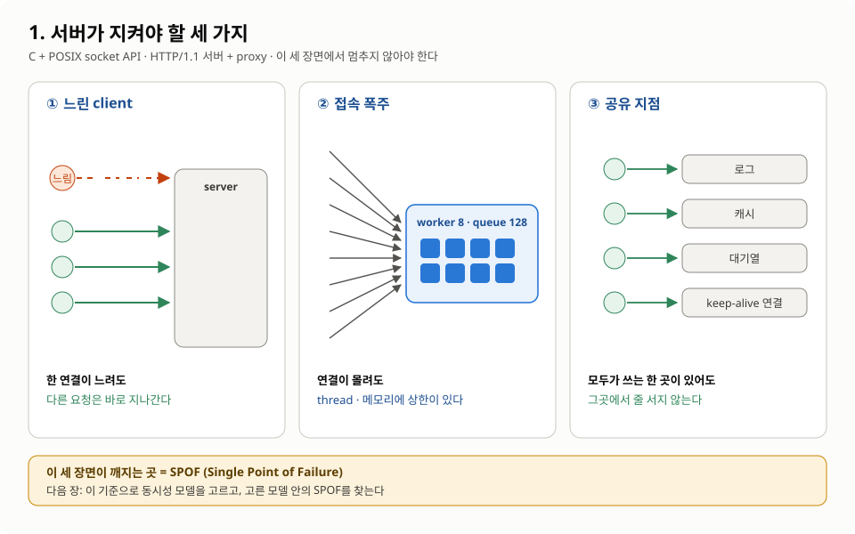
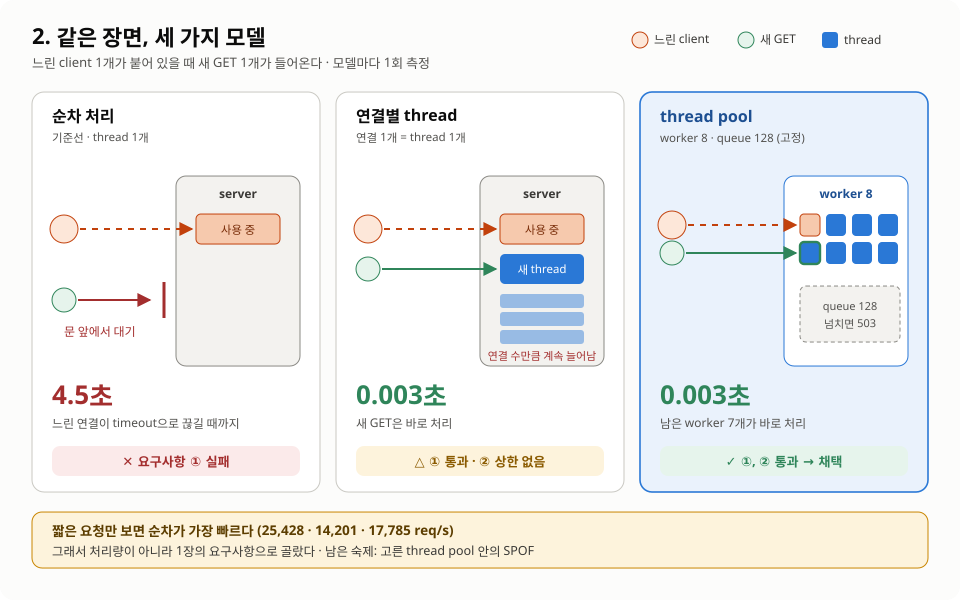
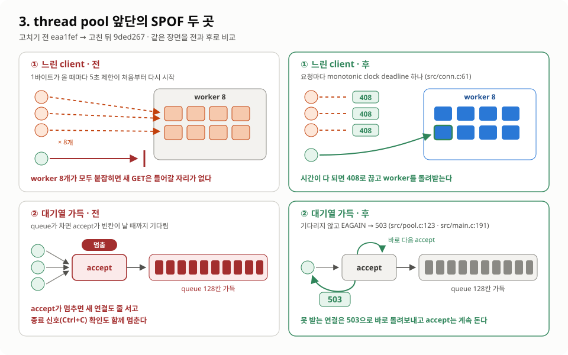
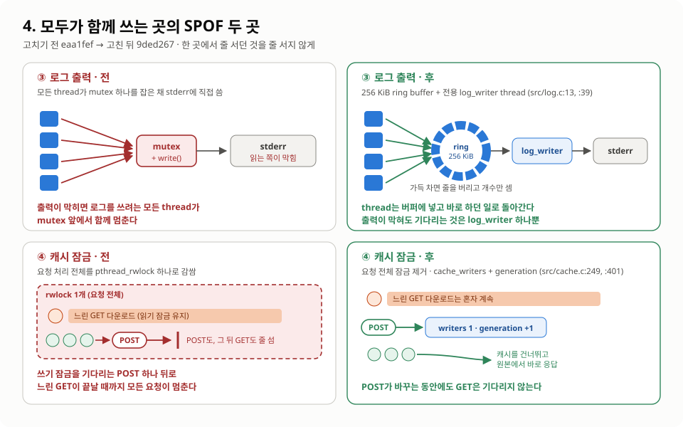
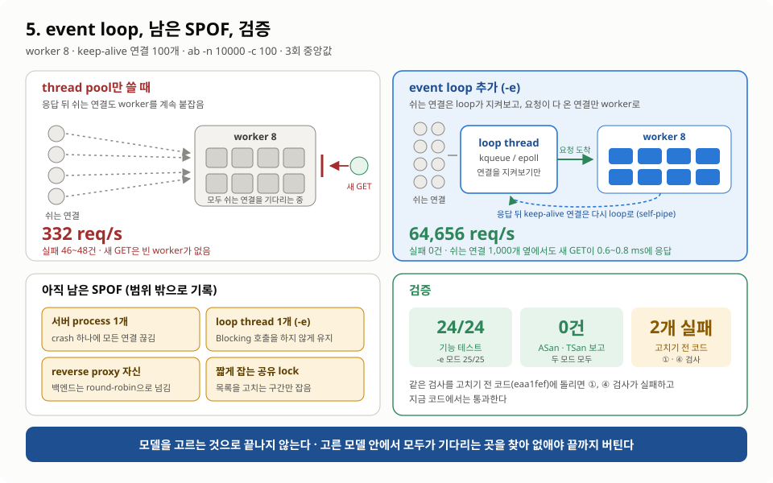

# 4분 발표 · 요구사항 → 모델 선택 → SPOF 해결

📌 [단일 독점 Import와 절대 기준 마스터 파일 준수 선언] 원문과 소스 근거 보존 · 띄어쓰기와 색상 구분 · 문체와 어휘 통제를 지킨다.

- 기준: fork `main` 커밋 `e2131d9`의 코드와 `presentation/README.md` 측정값.
- 그림: `images/story_01` ~ `story_05` (SVG 원본 + 같은 이름의 PNG).
- 읽는 법: `[화면]` 아래 문단이 실제로 말할 문장이다. 굵은 글씨는 강조해서 읽을 숫자다.
- 분량: 말할 문장 1,244자. 1초에 6자 안팎으로 읽으면 약 3분 27초이고, 장마다 배정 시간 안에 들어간다. 남는 30초는 그림을 넘기는 사이의 여유다.

---

## 1. 서버가 지켜야 할 세 가지 · 0:00 – 0:40

[화면] 세 칸 그림

안녕하세요. 저희는 C와 POSIX socket API만으로 HTTP 서버와 proxy를 만들었습니다. 기능보다 먼저, 이 서버가 지켜야 할 세 가지를 정했습니다. 첫째, 느린 client가 있어도 다른 요청은 바로 처리돼야 합니다. 둘째, 접속이 몰려도 thread와 메모리에 상한이 있어야 합니다. 셋째, 로그나 캐시처럼 모두가 쓰는 한 곳 때문에 전체가 멈추면 안 됩니다. 이 세 가지가 깨지는 곳을 SPOF라고 부릅니다.

## 2. 같은 장면, 세 가지 모델 · 0:40 – 1:30

[화면] 왼쪽부터 한 칸씩

느린 client 하나가 붙어 있을 때 새 GET 하나를 보냈습니다. 순차 처리는 thread가 하나라서 새 GET이 **4.5**초를 기다렸습니다. 연결별 thread는 **0.003**초에 응답했지만, 연결이 늘면 thread도 끝없이 늘어납니다. thread pool은 worker **8**개와 queue **128**칸으로 상한을 두고도 **0.003**초에 응답했습니다. 짧은 요청만 보면 순차가 가장 빨랐지만, 저희는 처리량이 아니라 요구사항으로 thread pool을 골랐습니다.

## 3. thread pool 앞단의 SPOF 두 곳 · 1:30 – 2:25

[화면] 위쪽 ①, 아래쪽 ②

그런데 고른 thread pool 안에도 모두가 지나가는 곳이 있었습니다. 첫째, 1바이트씩 보내는 느린 client는 바이트가 올 때마다 **5**초 제한이 다시 시작돼서, worker **8**개를 모두 붙잡을 수 있었습니다. 요청마다 monotonic clock deadline 하나를 두고, 시간이 다 되면 **408**로 끊어 worker를 돌려받게 했습니다. 둘째, queue가 가득 차면 accept가 빈칸을 기다리며 멈췄습니다. 이제는 기다리지 않고 **503**으로 바로 돌려보내고, accept는 계속 돕니다.

## 4. 모두가 함께 쓰는 곳의 SPOF 두 곳 · 2:25 – 3:15

[화면] 위쪽 ③, 아래쪽 ④

셋째는 로그였습니다. 모든 thread가 mutex 하나를 잡고 직접 출력해서, 출력이 막히면 모두 멈췄습니다. 지금은 **256** KiB ring buffer에 넣고, 출력은 전용 thread 하나가 맡습니다. 넷째는 캐시 잠금이었습니다. 요청 전체를 잠금 하나로 감싸서, 느린 GET 하나 때문에 POST와 다른 GET이 줄을 섰습니다. 지금은 POST가 바꾸는 동안 GET이 캐시를 건너뛰고 원본에서 바로 응답합니다.

## 5. event loop, 남은 SPOF, 검증 · 3:15 – 4:00

[화면] 위쪽 두 칸, 아래 두 칸

마지막으로 쉬는 keep-alive 연결이 worker를 붙잡아 **332** req/s까지 떨어졌습니다. kqueue와 epoll로 event loop를 더해 쉬는 연결은 loop가 지켜보게 했고, **64,656** req/s, 실패 **0**건이 나왔습니다. 기능 테스트 **24/24**, sanitizer 보고 **0**건입니다. 모델을 고르는 것으로 끝나지 않고, 그 안에서 모두가 기다리는 곳을 없애야 서버가 버틴다는 것을 배웠습니다. 감사합니다.

---

## Q&A 대비

**Q. 순차 처리가 더 빠른데 왜 안 썼나요?**
짧은 요청에서는 thread를 만들고 바꾸는 비용이 없어서 빠릅니다. 하지만 느린 client 하나에 전체가 줄을 서므로 요구사항 ①을 지키지 못합니다.

**Q. event loop가 있으면 worker가 필요 없나요?**
아닙니다. loop는 연결을 지켜보기만 하고, 요청 처리와 응답 송신은 여전히 worker가 Blocking으로 합니다. 쉬는 연결이 worker를 붙잡지 않게 한 것이 핵심입니다.

**Q. ②와 ③도 테스트로 확인했나요?**
①과 ④는 고치기 전 코드에서 실패하고 지금 통과하는 검사가 있습니다. ②와 ③은 코드를 읽어 찾은 문제이며, 실패를 재현하는 검사는 아직 없습니다.

**Q. 측정값은 믿을 만한가요?**
같은 Mac의 loopback에서 debug build로 쟀습니다. 처리량 비교는 3~4회 중앙값이고, 느린 client 측정은 모델마다 1회입니다. 절대값보다 같은 조건끼리의 차이로 봐 주시면 됩니다.

**Q. 남은 SPOF는 무엇인가요?**
서버 process가 하나라서 crash 하나에 모든 연결이 끊깁니다. event loop 모드에서는 loop thread 하나, reverse proxy 구성에서는 proxy 자신이 SPOF입니다. 여러 process나 여러 서버로 나누는 구조는 이번 범위 밖입니다.
