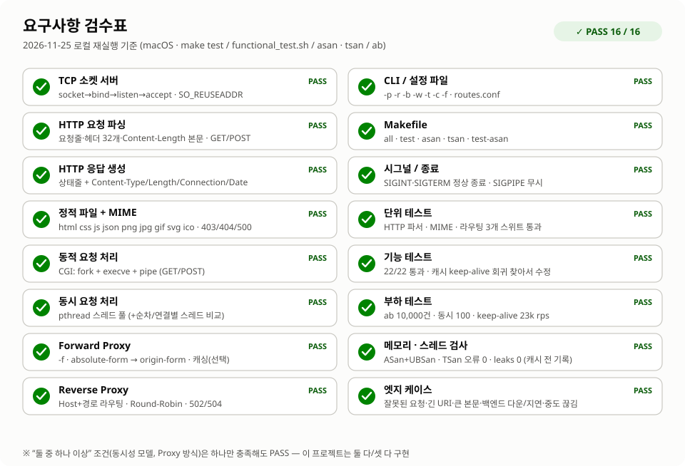
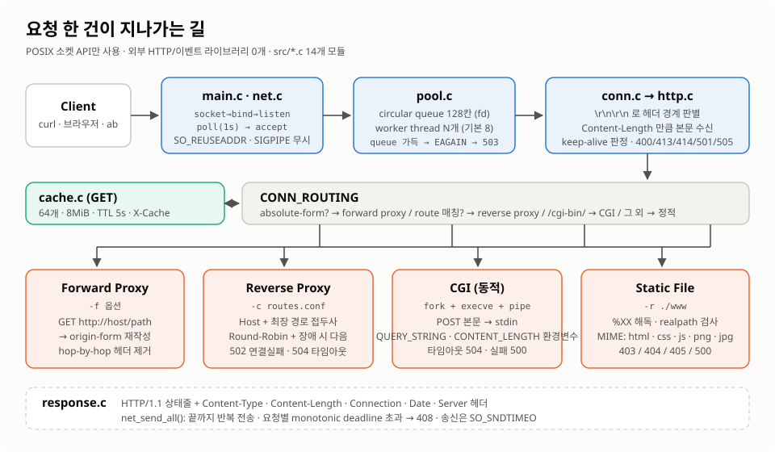
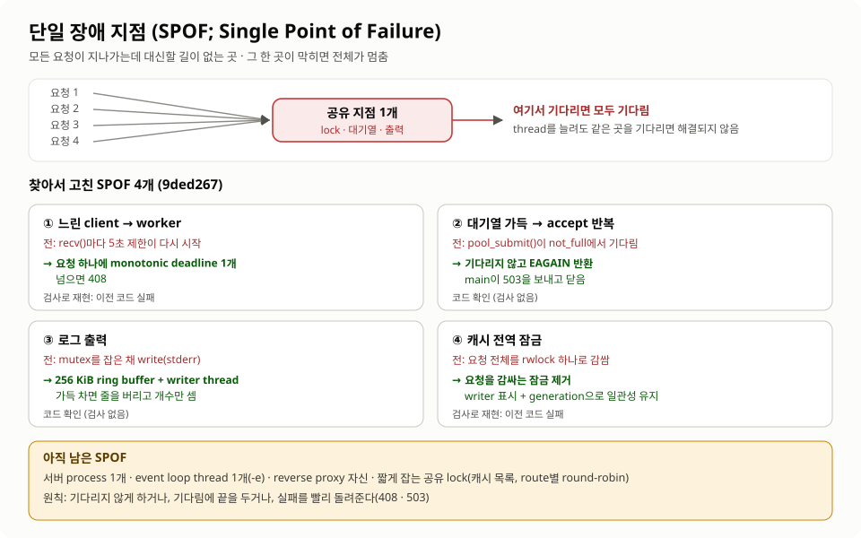

# C로 밑바닥부터 만든 웹서버 + 프록시

> **POSIX 소켓 API만으로** 만든 HTTP/1.1 서버입니다. 정적 파일, CGI, **Forward Proxy와 Reverse Proxy(Round-Robin)**, 스레드 풀, GET 캐시를 구현했습니다.
> 외부 HTTP·이벤트 라이브러리는 쓰지 않았습니다. `src/*.c` 15개 파일, 약 3,900줄입니다(2026-11-26 `main` 기준).

| 목차 | 내용 |
|---|---|
| 1. 무엇을 만들었나 | 요구사항 검수표 |
| 2. 요청 한 건이 지나가는 길 | 전체 구조, 상태 머신 |
| 3. Proxy 두 가지 | Forward vs Reverse |
| 4. 연결 처리 방식과 C10K | 부하 테스트, event loop |
| 5. 단일 장애 지점(SPOF) | 찾은 SPOF 4개와 수정, 남은 SPOF |
| 6. 배운 점 · 다음 단계 | — |

---

## 1. 무엇을 만들었나



- 필수 항목 **16개 모두 통과**했습니다. 단, 기능 테스트는 처음엔 19/21이었습니다. 원인을 찾아 고친 뒤 22/22가 되었고, 이후 느린 client 대응 검사 2건을 더해 현재 **24/24**입니다(5장 SPOF).
- "둘 중 하나 이상"인 조건은 하나만 맞아도 되지만 둘 다 구현했습니다.
  - Proxy: Forward와 Reverse를 **둘 다** 구현했습니다.
  - 동시 처리: 스레드 풀(채택)과 연결별 스레드, 두 가지 **동시성 모델**을 만들고, 동시성이 없는 **순차 처리 기준선**과 브랜치별로 비교했습니다.

```sh
make && ./build/server -p 8080 -r ./www -w 8 -c routes.conf.example -f
```

| 옵션 | 의미 | 옵션 | 의미 |
|---|---|---|---|
| `-p` | 포트 | `-w` | worker 수 (1–256) |
| `-r` | 정적 루트 | `-t` | 소켓 타임아웃(초) |
| `-b` | listen backlog | `-c` | 리버스 프록시 규칙 파일 |
| `-f` | 포워드 프록시 켜기 | `-h` | 도움말 |

---

## 2. 요청 한 건이 지나가는 길



**핵심 동작**
1. `socket → bind → listen`. 소켓에 `SO_REUSEADDR`를 켜서, 재시작할 때 `TIME_WAIT` 때문에 `bind`가 실패하지 않게 했습니다.
2. listen 소켓은 **non-blocking으로 두고 `poll(1초)`로 대기**합니다. 그래서 `Ctrl+C`(SIGINT/SIGTERM)를 받으면 1초 안에 루프를 빠져나와 worker를 join하고 정상 종료합니다.
3. 연결 소켓은 다시 blocking으로 바꾸고(`src/main.c:157`), 요청 하나를 읽는 데 쓸 수 있는 시간을 **monotonic clock 기준 deadline**(`src/conn.c:45–66`)으로 제한합니다. `recv()` 전에 `net_wait(POLLIN)`으로 남은 시간만큼만 기다리므로, 헤더를 조금씩 흘려 보내는 연결도 deadline에 408로 끊깁니다. `SO_RCVTIMEO`/`SO_SNDTIMEO`(`src/net.c:91–98`)는 송신과 `recv()` 단위의 보조 제한으로 남아 있습니다.
4. worker와 대기열(circular queue 128칸)이 모두 차면 `pool_submit()`이 기다리지 않고 `EAGAIN`을 돌려주고(`src/pool.c:107–`), `main`이 **503**을 보내 닫습니다(`src/main.c:192–196`). 종료할 때 아직 시작하지 않은 대기 연결도 503으로 돌려보냅니다(`src/main.c:206`).
5. `SIGPIPE`는 무시합니다(+ macOS `SO_NOSIGPIPE`). 그래서 클라이언트가 응답 도중에 끊어도 서버가 죽지 않습니다.


**HTTP 경계를 어떻게 찾나?**
- 헤더의 끝은 `\r\n\r\n`입니다. 이 표시가 올 때까지 `recv()`로 버퍼에 이어 붙입니다.
- 본문은 `Content-Length` 바이트만큼만 더 읽습니다. 상한은 1 MiB이고, 넘으면 413을 보냅니다.
- keep-alive일 때는 **처리한 요청 길이만큼만 버퍼에서 잘라내고(`memmove`)**, 남은 바이트로 다음 요청을 이어서 처리합니다.
- 어떤 경로로 끝나든 `CLOSING` 한 곳에서 `free(body)`와 `close(fd)`를 합니다. 그래서 자원 회수 코드가 흩어지지 않습니다.

---

## 3. Proxy 두 가지


| | Forward Proxy | Reverse Proxy |
|---|---|---|
| 누구를 대신하나 | **클라이언트** (서버는 진짜 클라이언트를 모름) | **서버** (클라이언트는 백엔드를 모름) |
| 우리 구현 | `-f` + `GET http://host:port/path` | `-c routes.conf` (Host + 최장 접두사) |
| 핵심 처리 | absolute-form을 origin-form으로 바꾸고, hop-by-hop 헤더 제거 | mutex로 보호한 Round-Robin, 실패하면 다음 백엔드 시도 |
| 장애 응답 | 연결 실패 502 / 타임아웃 504 | 전 백엔드 실패 502 / 지연 504 |
| 보안 처리 | 헤더 CR/LF 주입 차단, `https://`는 400, `CONNECT`는 501 | `X-Forwarded-For` 추가, 내부 주소 은닉 |

```text
# routes.conf : HOST  PREFIX  BACKEND...
*  /api/  127.0.0.1:8001 127.0.0.1:8002
```

---

## 4. 연결 처리 방식과 C10K


**용어부터:** 순차 처리는 연결을 한 번에 하나만 처리하므로 **동시성 모델이 아닙니다.** 동시성이 없을 때의 **기준선**입니다. 비교 대상은 두 가지 동시성 모델(연결별 스레드, 스레드 풀)입니다.

| 방식 | 장점 | 단점 |
|---|---|---|
| 순차 처리 (기준선, 동시성 없음) | 단순하고 경쟁 상태가 없음. 짧은 요청에서는 가장 빠름 | 느린 client 1개가 모든 연결을 막음 |
| 연결별 스레드 | 구현이 쉬움. 느린 client가 다른 연결을 막지 않음 | 연결 수만큼 스레드와 스택이 생김. 폭주하면 메모리 고갈 |
| **스레드 풀 (채택)** | 스레드 수가 고정되어 자원을 예측할 수 있음 | **keep-alive 연결이 worker를 점유함** |

**측정 ① 연결 처리 방식 3종** (`ab -n 2000 -c 50`, 각 브랜치 최신 커밋, 4회 중앙값, 169 bytes 정적 파일)
- 순차 **25,428** · 연결별 스레드 **14,201** · 스레드 풀 **17,785** req/s입니다. 작고 빠른 요청에서는 스레드 생성·전환 비용 때문에 **순차가 가장 빠릅니다.** 그래서 이 숫자만으로 동시성의 가치를 말할 수 없습니다.
- 동시성이 필요한 이유는 느린 client입니다. 헤더를 끝내지 않는 연결 1개를 열어 둔 상태에서 일반 `GET` 1건이 걸린 시간은 순차 **4.5초**(느린 연결이 서버 timeout 5초로 끊길 때까지 대기), 연결별 스레드 **0.003초**, 스레드 풀 **0.003초**였습니다(모델마다 1회).

**측정 ② keep-alive와 worker 수** (`ab -n 10000 -c 100`, HEAD, 3회 중앙값)
- worker 8 + keep-alive는 **332 req/s, 실패 46~48건**입니다. 캐시를 끄고(`Cookie` 헤더로 우회) 재도 **329 req/s, 실패 47~48건**으로 같습니다. 캐시가 들어오기 전 코드(`56ef9f8`)와 수정 직후 코드(`eaa1fef`)에서도 326 · 328 req/s, 실패 47 · 48건이었습니다(각 1회).
- 반대로 `78b04af`는 캐시가 연결을 매번 닫아 keep-alive 요청이 0건이었고, 같은 worker 8에서 15,638 req/s, 실패 0건이었습니다(1회). keep-alive를 켜자 오히려 느려지는 것은 **연결이 worker를 붙잡는 구조** 때문이라는 해석과 맞습니다.
- 서버 로그의 `timed out` 48줄과 ab의 `Length` 실패 48건은 개수가 같습니다. 요청 하나하나가 1:1로 대응하는지는 확인하지 못했습니다. 따라서 "worker가 모자라 대기하던 연결이 deadline을 넘겨 끊겼다"는 설명은 **측정과 맞는 해석**이지 증명은 아닙니다.
- worker 128로 늘리면 실패가 0건입니다. 하지만 스레드를 늘려 문제를 덮은 것입니다.

**측정 ③ worker 128 · keep-alive 처리량이 오른 이유는 아직 나누지 못했습니다**

| 코드 | req/s (3회 중앙값) | 의미 |
|---|---:|---|
| `56ef9f8` | 17,360 | 캐시 없음 |
| `78b04af` | 15,852 | 캐시 있음, 연결 강제 종료(keep-alive 요청 0건) |
| `eaa1fef` | 25,912 | keep-alive 수정 |
| `9e6883a` (HEAD) | 70,110 | SPOF 수정 포함 |
| HEAD, 캐시 끔 | 30,261 | 같은 코드에서 캐시만 우회 |

- 25,912 → 70,110은 `9ded267`이 한 번에 바꾼 로그 thread, 캐시 전역 잠금 제거, deadline 방식을 따로 측정하지 못해 **어느 변경의 몫인지 말할 수 없습니다.** 캐시 HIT 자체는 HEAD에서 30,261 → 70,110(약 2.3배)입니다.
- 이전 README의 "15,105 → 23,364 req/s"는 서로 다른 시점의 단회 측정이라 이 표로 대체했습니다.
- **결론**: 연결 하나당 스레드 하나를 쓰는 구조는 C10K에서 한계가 있습니다. 해결책은 `epoll`/`kqueue` event loop로 연결과 스레드를 분리하는 것이고, 아래처럼 **`feature/event-loop` 브랜치에서 구현하고 테스트한 뒤 `main`에 합쳤습니다.** `./build/server -e`로 실행합니다.

### 4-1. event loop 구현 (`-e` 옵션)


**구조:** loop thread 하나가 `kqueue`(macOS) 또는 `epoll`(Linux)로 listen socket과 모든 대기 연결을 감시합니다. 헤더 끝(`\r\n\r\n`)까지 도착한 연결만 worker에 넘기고, 응답 뒤 keep-alive로 다음 요청을 기다리는 연결은 loop가 다시 맡습니다. 그래서 쉬는 연결이 worker를 붙잡지 않습니다.

| 부분 | 파일 · 함수 | 하는 일 |
|---|---|---|
| loop thread | `src/evloop.c` `evloop_run()` | accept, one-shot 읽기 감시, worker에 넘기기, deadline 지나면 408/종료, 종료 신호 처리 |
| 읽기 단계 | `src/conn.c` `conn_read_available()` | 소켓은 Blocking으로 두고 `recv(..., MSG_DONTWAIT)`로 지금 온 바이트만 읽음 |
| 처리 단계 | `src/conn.c` `conn_resume()` | 기존 상태 머신(PARSING → ROUTING → RESPONDING)을 그대로 실행하고, 다음 요청이 아직 없으면 `PARKED`를 돌려줌 |
| 되돌리기 | worker → self-pipe → loop | worker가 keep-alive 연결을 목록에 넣고 pipe에 1바이트를 써서 loop를 깨움 |
| 실행 | `./build/server -e` | 기본값은 기존 thread pool이고, `-e`를 주면 event loop로 동작 |

**테스트 (2026-11-26, 로컬)**

| 검사 | 결과 |
|---|---|
| 단위 테스트 (`make test`, `make test-asan`) | 4개 스위트 통과. 새 `tests/test_conn_event.c`가 socketpair로 헤더 일부 → 대기, 헤더 끝 → 처리, keep-alive → `PARKED`, pipelining 2건, 상대 종료, 잘못된 요청 400을 검사 |
| 기능 테스트 (`SERVER_MODE=event ./scripts/functional_test.sh`) | **25/25** (기존 24개 + "쉬는 keep-alive 연결 12개(worker 4개)와 함께 새 요청 즉시 처리"). 기본 모드는 24/24로 그대로 |
| ASan + UBSan · TSan | 두 모드 모두 기능 테스트 통과, sanitizer 보고 0 |
| 부하 (worker 8 · keep-alive) | thread pool **332 req/s**, 실패 46~48건 → event loop **64,656 req/s, 실패 0건** (3회 중앙값) |
| 쉬는 연결 N개 + 새 GET (worker 8) | thread pool은 200개 중 136개만 응답(= worker 8 + 대기열 128), 새 GET은 503. event loop는 200개 · 1000개 모두 응답, 새 GET 200 (0.6~0.8 ms) |

**테스트하다 고친 문제:** TSan 빌드에서 event 모드 서버가 SIGTERM을 받고도 끝나지 않았습니다. macOS TSan은 시그널 핸들러를 가로챈 함수에 들어갈 때까지 미루는데, loop는 `kevent`만 부르고 있었기 때문입니다. SIGINT/SIGTERM을 `EVFILT_SIGNAL`로 kqueue에도 넣어, 핸들러가 늦어도 loop가 종료 요청을 받게 고쳤습니다.

**남은 한계**
- 요청 처리(정적 파일 · CGI · proxy 응답 송신, 큰 본문 수신)는 여전히 worker에서 Blocking으로 돕니다. 느린 다운로드나 느린 본문 업로드는 deadline까지 worker 하나를 씁니다.
- Linux `epoll` 경로는 이 Mac에서 빌드 · 실행하지 못했습니다. stub 헤더로 형식 검사(`-fsyntax-only`)만 통과했습니다.
- 연결 하나에 8 KiB 읽기 버퍼를 힙에 둡니다. 1만 연결이면 약 80 MiB입니다. 마감 검사는 100 ms마다 대기 연결 목록 전체를 훑습니다.
- 측정 원문: [`docs/benchmarks/apachebench_2026-11-26_event_loop.txt`](../docs/benchmarks/apachebench_2026-11-26_event_loop.txt)

> 모든 수치는 같은 Mac의 loopback에서 `-O0` debug build로 2026-11-26 한 세션에 측정했고, 실행마다 흔들립니다(예: 같은 조건 3회가 24,550~31,992). 어제(2026-11-25) 기록과 값이 다른 것도 이 때문입니다.
> 원본 출력: [`docs/benchmarks/apachebench_2026-11-26_controlled.txt`](../docs/benchmarks/apachebench_2026-11-26_controlled.txt)

---

## 5. 단일 장애 지점(SPOF; Single Point of Failure)



**SPOF란:** 그 한 곳이 멈추거나 막히면 **시스템 전체가 함께 멈추는 지점**입니다. 서버에서는 "모든 요청이 반드시 지나가는데 대신할 길이 없는 곳"이 SPOF가 됩니다. thread를 여러 개 두어도, 모두가 같은 lock이나 같은 대기열 하나를 기다리면 그 lock과 대기열이 SPOF입니다.

### 5-1. 찾아서 고친 SPOF 4개 (`9ded267`)

| SPOF | 고치기 전 (`eaa1fef`) | 무엇이 전체를 멈추나 | 고친 뒤 (현재 코드) |
|---|---|---|---|
| ① 느린 client와 worker | `recv()`마다 `SO_RCVTIMEO` 5초가 새로 시작됨 (`src/conn.c:117`) | 헤더를 몇 초마다 1바이트씩 보내면 제한 시간이 계속 늘어나 worker 하나를 무한히 붙잡음. 이런 연결이 worker 수만큼 오면 서버 전체가 응답 불가 | 요청 하나에 **monotonic deadline** 하나 (`src/conn.c:60`, `:153`, `:235`). 남은 시간만큼만 기다리고 넘으면 408 |
| ② accept 반복과 worker 대기열 | 대기열이 차면 `pool_submit()`이 `not_full`에서 기다림 (`src/pool.c:120`) | accept 반복이 멈춰 새 연결도, 종료 신호(`g_stop`) 확인도 멈춤 | 기다리지 않고 `EAGAIN` (`src/pool.c:123`) → `main`이 **503**을 보내고 닫음 (`src/main.c:188`) |
| ③ 로그 출력 | 모든 thread가 같은 mutex를 잡은 채 `write(stderr)` (`src/log.c:25`, `:30`) | stderr를 읽는 쪽이 막히면 로그를 쓰려는 모든 thread가 그 mutex에서 멈춤 | 256 KiB ring buffer에 넣고 전용 writer thread가 출력 (`src/log.c:13`, `:39`). 가득 차면 줄을 버리고 개수만 셈 (`:106`) |
| ④ 캐시 전역 잠금 | 요청 전체를 `pthread_rwlock` 하나로 감쌈 (`src/conn.c:245`, `src/cache.c:242`) | non-GET 하나가 쓰기 잠금을 기다리는 동안, 느린 GET 다운로드 하나가 끝날 때까지 다른 모든 요청이 줄을 섬 | 요청을 감싸는 잠금 제거. non-GET은 writer 표시와 generation만 올리고 (`src/conn.c:298`, `src/cache.c:249`), 그동안 GET은 캐시를 건너뜀 (`src/cache.c:401`). 저장은 generation이 같을 때만 (`:598`) |

**검증 `[실측]`:** 지금의 기능 검사를 고치기 전 코드(`eaa1fef`)에 돌리면 24개 중 2개가 실패합니다.
- ① "헤더를 조금씩 보내는 연결은 제한 시간 뒤 408" → 응답 없음(6.0초)
- ④ "느린 GET 다운로드 중에도 POST와 GET 즉시 처리" → 시간 초과(3.0초)

현재 코드에서는 두 검사 모두 통과하고 ASan · TSan 보고는 0건입니다. ②와 ③은 코드를 읽어 찾은 문제이며, 실패를 재현하는 검사는 아직 없습니다.

### 5-2. 아직 남아 있는 SPOF

| SPOF | 왜 SPOF인가 | 지금의 대응 · 한계 |
|---|---|---|
| 서버 process 하나 | crash 하나에 모든 연결이 끊김 | 대신 받을 process가 없음. 여러 process나 여러 서버를 앞에서 나누는 구조는 범위 밖 |
| event loop thread 하나 (`-e`) | loop가 막히면 accept와 모든 대기 연결이 멈춤 | loop는 Blocking 호출을 하지 않음 (`MSG_DONTWAIT`, 오류 응답도 Non-blocking으로 한 번만 시도). 요청 처리는 worker가 맡음 |
| reverse proxy 자신 | 백엔드는 여러 개여도 앞단 proxy가 하나 | 백엔드 하나가 죽으면 다음 백엔드로 넘어감 (`src/proxy.c:299`, round-robin). proxy 이중화는 범위 밖 |
| 짧게 잡는 공유 lock | 캐시 목록 mutex, route별 round-robin mutex | 요청 전체가 아니라 목록을 고치는 짧은 구간만 잡음. 잡은 채로 네트워크 I/O를 하지 않음 |

> **정리:** SPOF는 "thread를 늘리면 해결"되지 않습니다. 모두가 기다리는 곳(lock, 대기열, 출력, 시간 제한)을 찾아 **기다리지 않게 하거나, 기다림에 끝을 두거나, 실패를 빨리 돌려주는 것(408 · 503)**이 이번 수정의 공통 원칙입니다.

---

## 6. 배운 점 · 다음 단계

**배운 점**
- TCP는 "메시지"가 아니라 **바이트 스트림**입니다. HTTP 경계는 `\r\n\r\n`과 `Content-Length`로 직접 찾아야 합니다.
- `send()`는 요청한 바이트를 다 보낸다는 보장이 없습니다. 그래서 `net_send_all()`로 끝까지 반복 전송합니다.
- 동시성 모델은 정답이 있는 문제가 아니라 **트레이드오프**입니다. 측정해 보기 전까지는 모릅니다.

**다음 단계**
1. ~~`kqueue`/`epoll` 이벤트 루프 버전을 만들어 keep-alive 부하 재측정~~ → 구현 · 측정 완료(4-1, `main`에 합침). 다음은 응답 송신까지 Non-blocking으로 옮기기와 Linux에서 `epoll` 경로 실행
2. Linux(Docker)에서 빌드하고 `valgrind` 검사
3. 헤더가 8 KiB 버퍼를 넘을 때 조용히 끊지 않고 431을 응답(현재는 로그만 남기고 연결을 닫음, `src/conn.c:141`)

---

<details>
<summary>부록: 요구사항 상세 검수 (근거 파일)</summary>

| 요구사항 | 판정 | 근거 |
|---|:-:|---|
| socket→bind→listen→accept | ✅ | `src/net.c` `net_listen()`, `src/main.c` accept 루프 |
| 요청 라인 · 헤더 · 본문 파싱, GET/POST | ✅ | `src/http.c` `http_parse()`, `src/conn.c` 본문 수신 |
| 상태 라인 + Content-Type/Length/Connection | ✅ | `src/response.c` `resp_format_head()` |
| 정적 파일 · MIME · 403/404/500 | ✅ | `src/static.c` (realpath로 루트 이탈 차단), `src/mime.c` |
| 동적 처리 (CGI 또는 백엔드 전달) | ✅ | `src/cgi.c` fork/execve/pipe, `src/proxy.c` |
| 동시 처리 (fork / pthread / I/O 멀티플렉싱 중 1개 이상) | ✅ | `src/pool.c` 스레드 풀(채택), 연결별 스레드 브랜치, CGI는 `fork()`, `kqueue`/`epoll` event loop(`-e`). 순차 브랜치는 비교 기준선 |
| Forward 또는 Reverse Proxy (1개 이상) | ✅ | 둘 다: `proxy_forward_cached()`, `proxy_reverse_cached()` + RR `route_pick()` |
| 라우팅: 경로 또는 Host 기반 | ✅ | `src/route.c` `route_match()` (둘 다) |
| CLI 인자 또는 설정 파일 | ✅ | `src/config.c` getopt, `routes.conf` |
| Makefile | ✅ | `all / test / asan / tsan / test-asan` |
| SIGINT/SIGTERM 안전 종료, SIGPIPE 무시 | ✅ | `src/main.c` sigaction + `pool_shutdown()` |
| 금지 라이브러리 미사용 | ✅ | 표준 C, POSIX, pthread만 사용 |
| 단위 테스트 | ✅ | `tests/test_http.c`, `test_mime.c`, `test_route.c`, `test_conn_event.c` |
| 기능 테스트 (curl, 동시 접속) | ✅ | 24/24. 캐시 keep-alive 회귀(`1c2c4bd`)와 느린 client 대응(`9ded267`) 반영 |
| 부하 테스트 | ✅ | `ab`, [`docs/benchmarks/`](../docs/benchmarks/) |
| 메모리 검사 (sanitizer 또는 valgrind) | ✅ | ASan+UBSan 오류 0, TSan 경고 0. leaks 0 bytes(캐시 추가 전) |
| 엣지 케이스 | ✅ | 400/413/414/431/501/505, 502/504, 408(느린 헤더), 503(대기열 가득), 클라이언트 중도 종료 |
| 이식성 고려 | △ | `#ifdef SO_NOSIGPIPE` 분기는 있음. Linux 빌드는 실행하지 않음 |

</details>
