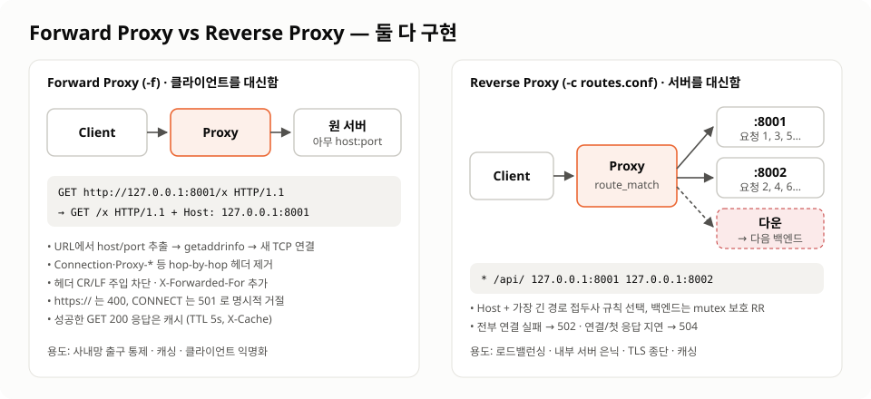
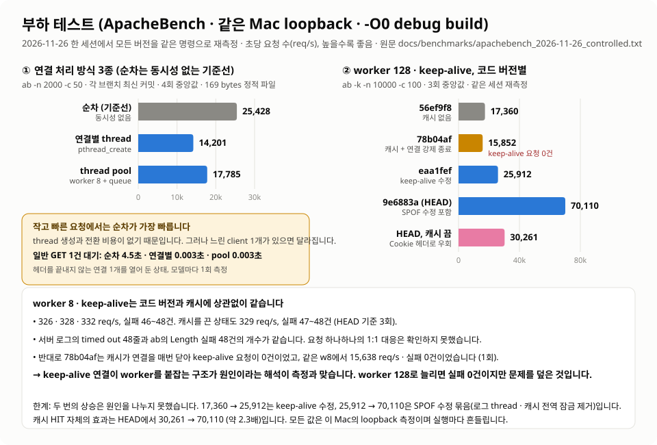
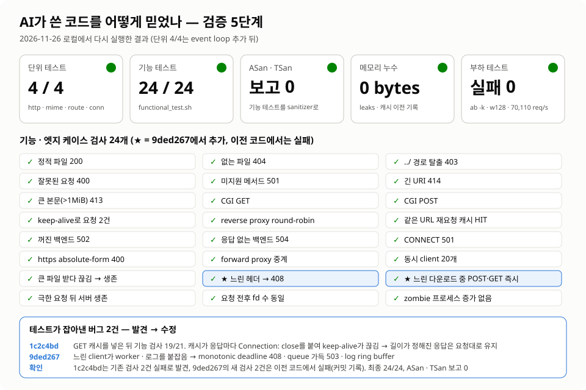

# C로 밑바닥부터 만든 웹서버 + 프록시

> **POSIX 소켓 API만으로** 만든 HTTP/1.1 서버입니다. 정적 파일, CGI, **Forward Proxy와 Reverse Proxy(Round-Robin)**, 스레드 풀, GET 캐시를 구현했습니다.
> 외부 HTTP·이벤트 라이브러리는 쓰지 않았습니다. `src/*.c` 14개 모듈, 약 3,100줄입니다.

| 발표 순서 (4분) | 시간 | 보여줄 그림 |
|---|---:|---|
| 1. 무엇을 만들었나 | 0:00 – 0:30 | 요구사항 검수표 |
| 2. 요청 한 건이 지나가는 길 | 0:30 – 1:20 | 전체 구조, 상태 머신 |
| 3. Proxy 두 가지 | 1:20 – 2:00 | Forward vs Reverse |
| 4. 동시성 모델과 C10K | 2:00 – 2:50 | 부하 테스트 |
| 5. AI 코드 검증 — 버그 발견과 수정 | 2:50 – 3:40 | 검증 5단계 |
| 6. 배운 점 · 다음 단계 | 3:40 – 4:00 | — |

---

## 1. 무엇을 만들었나 `0:00`


- 필수 항목 **16개 모두 통과**했습니다. 단, 기능 테스트는 처음엔 19/21이었습니다. 원인을 찾아 고친 뒤 22/22가 되었습니다(5장).
- "둘 중 하나 이상"인 조건은 하나만 맞아도 되지만 둘 다 구현했습니다.
  - Proxy: Forward와 Reverse를 **둘 다** 구현했습니다.
  - 동시성: 스레드 풀, 연결별 스레드, 순차 처리를 각각 브랜치로 만들어 **세 모델을 비교**했습니다.

```sh
make && ./build/server -p 8080 -r ./www -w 8 -c routes.conf.example -f
```

| 옵션 | 의미 | 옵션 | 의미 |
|---|---|---|---|
| `-p` | 포트 | `-w` | worker 수 (1–256) |
| `-r` | 정적 루트 | `-t` | 소켓 타임아웃(초) |
| `-b` | listen backlog | `-c` | 리버스 프록시 규칙 파일 |
| `-f` | 포워드 프록시 켜기 | `-h` | 도움말 |

---

## 2. 요청 한 건이 지나가는 길 `0:30`


**말할 포인트**
1. `socket → bind → listen`. 소켓에 `SO_REUSEADDR`를 켜서, 재시작할 때 `TIME_WAIT` 때문에 `bind`가 실패하지 않게 했습니다.
2. listen 소켓은 **non-blocking으로 두고 `poll(1초)`로 대기**합니다. 그래서 `Ctrl+C`(SIGINT/SIGTERM)를 받으면 1초 안에 루프를 빠져나와 worker를 join하고 정상 종료합니다.
3. 연결 소켓은 다시 **blocking + `SO_RCVTIMEO`** 로 바꿨습니다. 그래서 느린 클라이언트가 worker를 영원히 붙잡지 못합니다(408).
4. `SIGPIPE`는 무시합니다(+ macOS `SO_NOSIGPIPE`). 그래서 클라이언트가 응답 도중에 끊어도 서버가 죽지 않습니다.


**HTTP 경계를 어떻게 찾나?**
- 헤더의 끝은 `\r\n\r\n`입니다. 이 표시가 올 때까지 `recv()`로 버퍼에 이어 붙입니다.
- 본문은 `Content-Length` 바이트만큼만 더 읽습니다. 상한은 1 MiB이고, 넘으면 413을 보냅니다.
- keep-alive일 때는 **처리한 요청 길이만큼만 버퍼에서 잘라내고(`memmove`)**, 남은 바이트로 다음 요청을 이어서 처리합니다.
- 어떤 경로로 끝나든 `CLOSING` 한 곳에서 `free(body)`와 `close(fd)`를 합니다. 그래서 자원 회수 코드가 흩어지지 않습니다.

---

## 3. Proxy 두 가지 `1:20`



| | Forward Proxy | Reverse Proxy |
|---|---|---|
| 누구를 대신하나 | **클라이언트** (서버는 진짜 클라이언트를 모름) | **서버** (클라이언트는 백엔드를 모름) |
| 우리 구현 | `-f` + `GET http://host:port/path` | `-c routes.conf` (Host + 최장 접두사) |
| 핵심 처리 | absolute-form을 origin-form으로 바꾸고, hop-by-hop 헤더 제거 | mutex로 보호한 Round-Robin, 실패하면 다음 백엔드 시도 |
| 장애 응답 | 연결 실패 502 / 타임아웃 504 | 전 백엔드 실패 502 / 지연 504 |
| 보안 처리 | 헤더 CR/LF 주입 차단, `https://`는 400, `CONNECT`는 501 | `X-Forwarded-For` 추가, 내부 주소 은닉 |

```text
# routes.conf : HOST  PREFIX  BACKEND...
*  /api/  127.0.0.1:8001 127.0.0.1:8002
```

---

## 4. 동시성 모델과 C10K `2:00`



| 모델 | 장점 | 단점 |
|---|---|---|
| 순차 처리 | 단순하고 경쟁 상태가 없음 | 느린 요청 하나가 모두를 막음 |
| 연결별 스레드 | 구현이 쉽고 측정 성능도 좋았음 | 연결 수만큼 스레드와 스택이 생김. 폭주하면 메모리 고갈 |
| **스레드 풀 (채택)** | 스레드 수가 고정되어 자원을 예측할 수 있음 | **keep-alive 연결이 worker를 점유함** |

- 동시 keep-alive 연결이 100개인데 worker가 8개면 나머지 92개가 기다립니다. 회귀를 고친 뒤 다시 재도 328 rps, 실패 48건이었습니다. 캐시 버그가 아니라 구조의 한계입니다.
- worker를 128개로 늘리면 23,364 rps, 실패 0건입니다(캐시 이전 기록은 15,105). 하지만 이는 스레드를 늘려 문제를 덮은 것입니다.
- **결론**: 연결 하나당 스레드 하나를 쓰는 구조는 C10K에서 한계가 있습니다. 해결책은 `epoll`/`kqueue` 이벤트 루프로 연결과 스레드를 분리하는 것입니다(다음 단계).

> 위 비교는 같은 Mac의 loopback에서 `-O0` 디버그 빌드로 측정했습니다. 일반적인 성능 보장이 아닙니다.
> 원본 출력: [`docs/benchmarks/`](../docs/benchmarks/)

---

## 5. AI가 쓴 코드를 어떻게 믿었나 `2:50`



| 단계 | 명령 | 결과 (2026-11-25 수정 후 재실행) |
|---|---|---|
| 단위 테스트 | `make test`, `make test-asan` | HTTP 파서 · MIME · 라우팅 **3/3 통과** |
| 기능 테스트 | `./scripts/functional_test.sh` | **22/22 통과** (수정 전 19/21) |
| 메모리 오류 | `make asan` 후 기능 테스트 | AddressSanitizer + UBSan **오류 0** |
| 데이터 경쟁 | `make tsan` 후 기능 테스트 | ThreadSanitizer **경고 0** |
| 메모리 누수 | `leaks --atExit` | **0 bytes**. 단, 캐시 추가 전에 기록한 값입니다 |
| 부하 | 서버 `-w 128` + `ab -k -n 10000 -c 100` | 23,364 rps, **실패 0** |

**검증하다 발견한 버그 — 발견 → 원인 → 수정**

| | 내용 |
|---|---|
| 발견 | 마지막에 GET 캐시를 넣은 뒤 기능 테스트가 19/21로 떨어졌습니다. keep-alive 검사와 Round-Robin 검사가 실패했습니다. |
| 원인 | `cache.c`가 MISS·HIT 응답에 **항상** `Connection: close`를 붙였습니다. `conn.c`도 캐시를 거친 요청이면 연결을 강제로 닫았습니다. 그래서 정적 파일 keep-alive가 사실상 꺼져 있었습니다. |
| 수정 | 길이가 정해진 응답(정적 파일, 캐시 HIT)은 클라이언트 요청대로 `keep-alive`를 유지합니다. 업스트림 EOF까지 중계하는 프록시 MISS만 `close`를 유지합니다. `conn.c`는 캐시가 실제로 보낸 값을 따릅니다. |
| 테스트 | 같은 URL 두 번은 캐시 HIT가 정상 동작입니다. 그래서 RR 검사는 서로 다른 URL로 바꾸고, "같은 URL 재요청 = HIT" 검사를 새로 추가했습니다. |
| 결과 | 22/22 통과, ASan/TSan 0. keep-alive 부하(worker 128)는 15,105 → 23,364 rps가 되었습니다. |

> **포인트:** "AI가 짠 코드가 돌아간다"에서 멈추지 않았습니다. 기존 테스트를 계속 다시 돌렸기 때문에 새 기능이 옛 기능을 깨뜨린 것을 바로 잡을 수 있었습니다.

**AI와 일한 방식**
- 단계별 작업 지시서(`docs/mac_tutorial_package/`)로 범위를 정했습니다. 각 단계의 결과는 실제 터미널 출력과 함께 [`docs/TUTORIAL_LOG.md`](../docs/TUTORIAL_LOG.md)에 기록했습니다.
- 숫자는 실행한 결과만 적었습니다. 재현하지 못한 항목(Linux 빌드, 6-1 경쟁 상태 재현)은 "미실행"으로 남겼습니다.

---

## 6. 배운 점 · 다음 단계 `3:40`

**배운 점**
- TCP는 "메시지"가 아니라 **바이트 스트림**입니다. HTTP 경계는 `\r\n\r\n`과 `Content-Length`로 직접 찾아야 합니다.
- `send()`는 요청한 바이트를 다 보낸다는 보장이 없습니다. 그래서 `net_send_all()`로 끝까지 반복 전송합니다.
- 동시성 모델은 정답이 있는 문제가 아니라 **트레이드오프**입니다. 측정해 보기 전까지는 모릅니다.

**다음 단계**
1. `kqueue`/`epoll` 이벤트 루프 버전을 만들어 keep-alive 부하 재측정
2. Linux(Docker)에서 빌드하고 `valgrind` 검사
3. 헤더가 8 KiB를 넘을 때 조용히 끊지 않고 431을 응답

---

<details>
<summary>부록: 요구사항 상세 검수 (근거 파일)</summary>

| 요구사항 | 판정 | 근거 |
|---|:-:|---|
| socket→bind→listen→accept | ✅ | `src/net.c` `net_listen()`, `src/main.c` accept 루프 |
| 요청 라인 · 헤더 · 본문 파싱, GET/POST | ✅ | `src/http.c` `http_parse()`, `src/conn.c` 본문 수신 |
| 상태 라인 + Content-Type/Length/Connection | ✅ | `src/response.c` `resp_format_head()` |
| 정적 파일 · MIME · 403/404/500 | ✅ | `src/static.c` (realpath로 루트 이탈 차단), `src/mime.c` |
| 동적 처리 (CGI 또는 백엔드 전달) | ✅ | `src/cgi.c` fork/execve/pipe, `src/proxy.c` |
| 동시 처리 (fork / pthread / I/O 멀티플렉싱 중 1개 이상) | ✅ | `src/pool.c` 스레드 풀, CGI는 `fork()` |
| Forward 또는 Reverse Proxy (1개 이상) | ✅ | 둘 다: `proxy_forward_cached()`, `proxy_reverse_cached()` + RR `route_pick()` |
| 라우팅: 경로 또는 Host 기반 | ✅ | `src/route.c` `route_match()` (둘 다) |
| CLI 인자 또는 설정 파일 | ✅ | `src/config.c` getopt, `routes.conf` |
| Makefile | ✅ | `all / test / asan / tsan / test-asan` |
| SIGINT/SIGTERM 안전 종료, SIGPIPE 무시 | ✅ | `src/main.c` sigaction + `pool_shutdown()` |
| 금지 라이브러리 미사용 | ✅ | 표준 C, POSIX, pthread만 사용 |
| 단위 테스트 | ✅ | `tests/test_http.c`, `test_mime.c`, `test_route.c` |
| 기능 테스트 (curl, 동시 접속) | ✅ | 22/22. 캐시 keep-alive 회귀를 찾아 수정 (`src/cache.c`, `src/conn.c`, `src/static.c`) |
| 부하 테스트 | ✅ | `ab`, [`docs/benchmarks/`](../docs/benchmarks/) |
| 메모리 검사 (sanitizer 또는 valgrind) | ✅ | ASan+UBSan 오류 0, TSan 경고 0. leaks 0 bytes(캐시 추가 전) |
| 엣지 케이스 | ✅ | 400/413/414/431/501/505, 502/504, 클라이언트 중도 종료 |
| 이식성 고려 | △ | `#ifdef SO_NOSIGPIPE` 분기는 있음. Linux 빌드는 실행하지 않음 |

</details>
