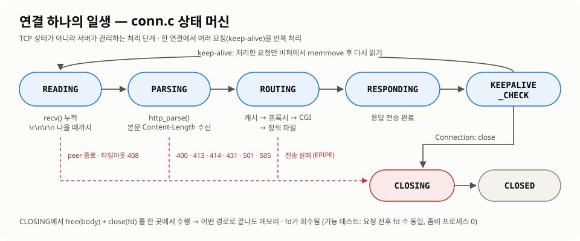
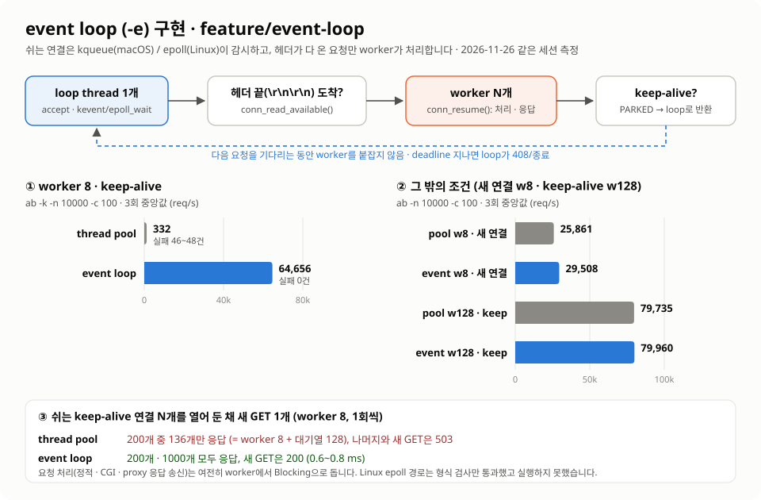

# C로 밑바닥부터 만든 웹서버 + 프록시

> **POSIX 소켓 API만으로** 만든 HTTP/1.1 서버입니다. 정적 파일, CGI, **Forward Proxy와 Reverse Proxy(Round-Robin)**, 스레드 풀, GET 캐시를 구현했습니다.
> 외부 HTTP·이벤트 라이브러리는 쓰지 않았습니다. `src/*.c` 14개 모듈, 약 3,300줄입니다(2026-11-26 HEAD `9e6883a` 기준).

| 발표 순서 (4분) | 시간 | 보여줄 그림 |
|---|---:|---|
| 1. 무엇을 만들었나 | 0:00 – 0:30 | 요구사항 검수표 |
| 2. 요청 한 건이 지나가는 길 | 0:30 – 1:20 | 전체 구조, 상태 머신 |
| 3. Proxy 두 가지 | 1:20 – 2:00 | Forward vs Reverse |
| 4. 연결 처리 방식과 C10K | 2:00 – 2:50 | 부하 테스트 |
| 5. AI 코드 검증 — 버그 발견과 수정 | 2:50 – 3:40 | 검증 5단계 |
| 6. 배운 점 · 다음 단계 | 3:40 – 4:00 | — |

---

## 1. 무엇을 만들었나 `0:00`


- 필수 항목 **16개 모두 통과**했습니다. 단, 기능 테스트는 처음엔 19/21이었습니다. 원인을 찾아 고친 뒤 22/22가 되었고, 이후 느린 client 대응 검사 2건을 더해 현재 **24/24**입니다(5장).
- "둘 중 하나 이상"인 조건은 하나만 맞아도 되지만 둘 다 구현했습니다.
  - Proxy: Forward와 Reverse를 **둘 다** 구현했습니다.
  - 동시 처리: 스레드 풀(채택)과 연결별 스레드, 두 가지 **동시성 모델**을 만들고, 동시성이 없는 **순차 처리 기준선**과 브랜치별로 비교했습니다.

```sh
make && ./build/server -p 8080 -r ./www -w 8 -c routes.conf.example -f
```

| 옵션 | 의미 | 옵션 | 의미 |
|---|---|---|---|
| `-p` | 포트 | `-w` | worker 수 (1–256) |
| `-r` | 정적 루트 | `-t` | 소켓 타임아웃(초) |
| `-b` | listen backlog | `-c` | 리버스 프록시 규칙 파일 |
| `-f` | 포워드 프록시 켜기 | `-h` | 도움말 |

---

## 2. 요청 한 건이 지나가는 길 `0:30`


**말할 포인트**
1. `socket → bind → listen`. 소켓에 `SO_REUSEADDR`를 켜서, 재시작할 때 `TIME_WAIT` 때문에 `bind`가 실패하지 않게 했습니다.
2. listen 소켓은 **non-blocking으로 두고 `poll(1초)`로 대기**합니다. 그래서 `Ctrl+C`(SIGINT/SIGTERM)를 받으면 1초 안에 루프를 빠져나와 worker를 join하고 정상 종료합니다.
3. 연결 소켓은 다시 blocking으로 바꾸고(`src/main.c:157`), 요청 하나를 읽는 데 쓸 수 있는 시간을 **monotonic clock 기준 deadline**(`src/conn.c:45–66`)으로 제한합니다. `recv()` 전에 `net_wait(POLLIN)`으로 남은 시간만큼만 기다리므로, 헤더를 조금씩 흘려 보내는 연결도 deadline에 408로 끊깁니다. `SO_RCVTIMEO`/`SO_SNDTIMEO`(`src/net.c:91–98`)는 송신과 `recv()` 단위의 보조 제한으로 남아 있습니다.
4. worker와 대기열(circular queue 128칸)이 모두 차면 `pool_submit()`이 기다리지 않고 `EAGAIN`을 돌려주고(`src/pool.c:107–`), `main`이 **503**을 보내 닫습니다(`src/main.c:192–196`). 종료할 때 아직 시작하지 않은 대기 연결도 503으로 돌려보냅니다(`src/main.c:206`).
5. `SIGPIPE`는 무시합니다(+ macOS `SO_NOSIGPIPE`). 그래서 클라이언트가 응답 도중에 끊어도 서버가 죽지 않습니다.



**HTTP 경계를 어떻게 찾나?**
- 헤더의 끝은 `\r\n\r\n`입니다. 이 표시가 올 때까지 `recv()`로 버퍼에 이어 붙입니다.
- 본문은 `Content-Length` 바이트만큼만 더 읽습니다. 상한은 1 MiB이고, 넘으면 413을 보냅니다.
- keep-alive일 때는 **처리한 요청 길이만큼만 버퍼에서 잘라내고(`memmove`)**, 남은 바이트로 다음 요청을 이어서 처리합니다.
- 어떤 경로로 끝나든 `CLOSING` 한 곳에서 `free(body)`와 `close(fd)`를 합니다. 그래서 자원 회수 코드가 흩어지지 않습니다.

---

## 3. Proxy 두 가지 `1:20`


| | Forward Proxy | Reverse Proxy |
|---|---|---|
| 누구를 대신하나 | **클라이언트** (서버는 진짜 클라이언트를 모름) | **서버** (클라이언트는 백엔드를 모름) |
| 우리 구현 | `-f` + `GET http://host:port/path` | `-c routes.conf` (Host + 최장 접두사) |
| 핵심 처리 | absolute-form을 origin-form으로 바꾸고, hop-by-hop 헤더 제거 | mutex로 보호한 Round-Robin, 실패하면 다음 백엔드 시도 |
| 장애 응답 | 연결 실패 502 / 타임아웃 504 | 전 백엔드 실패 502 / 지연 504 |
| 보안 처리 | 헤더 CR/LF 주입 차단, `https://`는 400, `CONNECT`는 501 | `X-Forwarded-For` 추가, 내부 주소 은닉 |

```text
# routes.conf : HOST  PREFIX  BACKEND...
*  /api/  127.0.0.1:8001 127.0.0.1:8002
```

---

## 4. 연결 처리 방식과 C10K `2:00`


**용어부터:** 순차 처리는 연결을 한 번에 하나만 처리하므로 **동시성 모델이 아닙니다.** 동시성이 없을 때의 **기준선**입니다. 비교 대상은 두 가지 동시성 모델(연결별 스레드, 스레드 풀)입니다.

| 방식 | 장점 | 단점 |
|---|---|---|
| 순차 처리 (기준선, 동시성 없음) | 단순하고 경쟁 상태가 없음. 짧은 요청에서는 가장 빠름 | 느린 client 1개가 모든 연결을 막음 |
| 연결별 스레드 | 구현이 쉬움. 느린 client가 다른 연결을 막지 않음 | 연결 수만큼 스레드와 스택이 생김. 폭주하면 메모리 고갈 |
| **스레드 풀 (채택)** | 스레드 수가 고정되어 자원을 예측할 수 있음 | **keep-alive 연결이 worker를 점유함** |

**측정 ① 연결 처리 방식 3종** (`ab -n 2000 -c 50`, 각 브랜치 최신 커밋, 4회 중앙값, 169 bytes 정적 파일)
- 순차 **25,428** · 연결별 스레드 **14,201** · 스레드 풀 **17,785** req/s입니다. 작고 빠른 요청에서는 스레드 생성·전환 비용 때문에 **순차가 가장 빠릅니다.** 그래서 이 숫자만으로 동시성의 가치를 말할 수 없습니다.
- 동시성이 필요한 이유는 느린 client입니다. 헤더를 끝내지 않는 연결 1개를 열어 둔 상태에서 일반 `GET` 1건이 걸린 시간은 순차 **4.5초**(느린 연결이 서버 timeout 5초로 끊길 때까지 대기), 연결별 스레드 **0.003초**, 스레드 풀 **0.003초**였습니다(모델마다 1회).

**측정 ② keep-alive와 worker 수** (`ab -n 10000 -c 100`, HEAD, 3회 중앙값)
- worker 8 + keep-alive는 **332 req/s, 실패 46~48건**입니다. 캐시를 끄고(`Cookie` 헤더로 우회) 재도 **329 req/s, 실패 47~48건**으로 같습니다. 캐시가 들어오기 전 코드(`56ef9f8`)와 수정 직후 코드(`eaa1fef`)에서도 326 · 328 req/s, 실패 47 · 48건이었습니다(각 1회).
- 반대로 `78b04af`는 캐시가 연결을 매번 닫아 keep-alive 요청이 0건이었고, 같은 worker 8에서 15,638 req/s, 실패 0건이었습니다(1회). keep-alive를 켜자 오히려 느려지는 것은 **연결이 worker를 붙잡는 구조** 때문이라는 해석과 맞습니다.
- 서버 로그의 `timed out` 48줄과 ab의 `Length` 실패 48건은 개수가 같습니다. 요청 하나하나가 1:1로 대응하는지는 확인하지 못했습니다. 따라서 "worker가 모자라 대기하던 연결이 deadline을 넘겨 끊겼다"는 설명은 **측정과 맞는 해석**이지 증명은 아닙니다.
- worker 128로 늘리면 실패가 0건입니다. 하지만 스레드를 늘려 문제를 덮은 것입니다.

**측정 ③ worker 128 · keep-alive 처리량이 오른 이유는 아직 나누지 못했습니다**

| 코드 | req/s (3회 중앙값) | 의미 |
|---|---:|---|
| `56ef9f8` | 17,360 | 캐시 없음 |
| `78b04af` | 15,852 | 캐시 있음, 연결 강제 종료(keep-alive 요청 0건) |
| `eaa1fef` | 25,912 | keep-alive 수정 |
| `9e6883a` (HEAD) | 70,110 | SPOF 수정 포함 |
| HEAD, 캐시 끔 | 30,261 | 같은 코드에서 캐시만 우회 |

- 25,912 → 70,110은 `9ded267`이 한 번에 바꾼 로그 thread, 캐시 전역 잠금 제거, deadline 방식을 따로 측정하지 못해 **어느 변경의 몫인지 말할 수 없습니다.** 캐시 HIT 자체는 HEAD에서 30,261 → 70,110(약 2.3배)입니다.
- 이전 README의 "15,105 → 23,364 req/s"는 서로 다른 시점의 단회 측정이라 이 표로 대체했습니다.
- **결론**: 연결 하나당 스레드 하나를 쓰는 구조는 C10K에서 한계가 있습니다. 해결책은 `epoll`/`kqueue` event loop로 연결과 스레드를 분리하는 것이고, 아래처럼 **`feature/event-loop` 브랜치에서 구현하고 테스트한 뒤 `main`에 합쳤습니다.** `./build/server -e`로 실행합니다.

### 4-1. event loop 구현 (`-e` 옵션)



**구조:** loop thread 하나가 `kqueue`(macOS) 또는 `epoll`(Linux)로 listen socket과 모든 대기 연결을 감시합니다. 헤더 끝(`\r\n\r\n`)까지 도착한 연결만 worker에 넘기고, 응답 뒤 keep-alive로 다음 요청을 기다리는 연결은 loop가 다시 맡습니다. 그래서 쉬는 연결이 worker를 붙잡지 않습니다.

| 부분 | 파일 · 함수 | 하는 일 |
|---|---|---|
| loop thread | `src/evloop.c` `evloop_run()` | accept, one-shot 읽기 감시, worker에 넘기기, deadline 지나면 408/종료, 종료 신호 처리 |
| 읽기 단계 | `src/conn.c` `conn_read_available()` | 소켓은 Blocking으로 두고 `recv(..., MSG_DONTWAIT)`로 지금 온 바이트만 읽음 |
| 처리 단계 | `src/conn.c` `conn_resume()` | 기존 상태 머신(PARSING → ROUTING → RESPONDING)을 그대로 실행하고, 다음 요청이 아직 없으면 `PARKED`를 돌려줌 |
| 되돌리기 | worker → self-pipe → loop | worker가 keep-alive 연결을 목록에 넣고 pipe에 1바이트를 써서 loop를 깨움 |
| 실행 | `./build/server -e` | 기본값은 기존 thread pool이고, `-e`를 주면 event loop로 동작 |

**테스트 (2026-11-26, 로컬)**

| 검사 | 결과 |
|---|---|
| 단위 테스트 (`make test`, `make test-asan`) | 4개 스위트 통과. 새 `tests/test_conn_event.c`가 socketpair로 헤더 일부 → 대기, 헤더 끝 → 처리, keep-alive → `PARKED`, pipelining 2건, 상대 종료, 잘못된 요청 400을 검사 |
| 기능 테스트 (`SERVER_MODE=event ./scripts/functional_test.sh`) | **25/25** (기존 24개 + "쉬는 keep-alive 연결 12개(worker 4개)와 함께 새 요청 즉시 처리"). 기본 모드는 24/24로 그대로 |
| ASan + UBSan · TSan | 두 모드 모두 기능 테스트 통과, sanitizer 보고 0 |
| 부하 (worker 8 · keep-alive) | thread pool **332 req/s**, 실패 46~48건 → event loop **64,656 req/s, 실패 0건** (3회 중앙값) |
| 쉬는 연결 N개 + 새 GET (worker 8) | thread pool은 200개 중 136개만 응답(= worker 8 + 대기열 128), 새 GET은 503. event loop는 200개 · 1000개 모두 응답, 새 GET 200 (0.6~0.8 ms) |

**테스트하다 고친 문제:** TSan 빌드에서 event 모드 서버가 SIGTERM을 받고도 끝나지 않았습니다. macOS TSan은 시그널 핸들러를 가로챈 함수에 들어갈 때까지 미루는데, loop는 `kevent`만 부르고 있었기 때문입니다. SIGINT/SIGTERM을 `EVFILT_SIGNAL`로 kqueue에도 넣어, 핸들러가 늦어도 loop가 종료 요청을 받게 고쳤습니다.

**남은 한계**
- 요청 처리(정적 파일 · CGI · proxy 응답 송신, 큰 본문 수신)는 여전히 worker에서 Blocking으로 돕니다. 느린 다운로드나 느린 본문 업로드는 deadline까지 worker 하나를 씁니다.
- Linux `epoll` 경로는 이 Mac에서 빌드 · 실행하지 못했습니다. stub 헤더로 형식 검사(`-fsyntax-only`)만 통과했습니다.
- 연결 하나에 8 KiB 읽기 버퍼를 힙에 둡니다. 1만 연결이면 약 80 MiB입니다. 마감 검사는 100 ms마다 대기 연결 목록 전체를 훑습니다.
- 측정 원문: [`docs/benchmarks/apachebench_2026-11-26_event_loop.txt`](../docs/benchmarks/apachebench_2026-11-26_event_loop.txt)

> 모든 수치는 같은 Mac의 loopback에서 `-O0` debug build로 2026-11-26 한 세션에 측정했고, 실행마다 흔들립니다(예: 같은 조건 3회가 24,550~31,992). 어제(2026-11-25) 기록과 값이 다른 것도 이 때문입니다.
> 원본 출력: [`docs/benchmarks/apachebench_2026-11-26_controlled.txt`](../docs/benchmarks/apachebench_2026-11-26_controlled.txt)

---

## 5. AI가 쓴 코드를 어떻게 믿었나 `2:50`


| 단계 | 명령 | 결과 (2026-11-26 HEAD `9e6883a` 재실행) |
|---|---|---|
| 단위 테스트 | `make test`, `make test-asan` | HTTP 파서 · MIME · 라우팅 **3/3 통과** |
| 기능 테스트 | `./scripts/functional_test.sh` | **24/24 통과** (캐시 도입 직후 19/21) |
| 메모리 오류 | `make asan` 후 기능 테스트 | AddressSanitizer + UBSan **오류 0** |
| 데이터 경쟁 | `make tsan` 후 기능 테스트 | ThreadSanitizer **경고 0** |
| 메모리 누수 | `leaks --atExit` | **0 bytes**. 단, 캐시 추가 전에 기록한 값입니다 |
| 부하 | 서버 `-w 128` + `ab -k -n 10000 -c 100` | 70,110 req/s(3회 중앙값), **실패 0** |

**검증하다 발견한 버그 — 발견 → 원인 → 수정**

| | 내용 |
|---|---|
| 발견 | 마지막에 GET 캐시를 넣은 뒤 기능 테스트가 19/21로 떨어졌습니다. keep-alive 검사와 Round-Robin 검사가 실패했습니다. |
| 원인 | `cache.c`가 MISS·HIT 응답에 **항상** `Connection: close`를 붙였습니다. `conn.c`도 캐시를 거친 요청이면 연결을 강제로 닫았습니다. 그래서 정적 파일 keep-alive가 사실상 꺼져 있었습니다. |
| 수정 | 길이가 정해진 응답(정적 파일, 캐시 HIT)은 클라이언트 요청대로 `keep-alive`를 유지합니다. 업스트림 EOF까지 중계하는 프록시 MISS만 `close`를 유지합니다. `conn.c`는 캐시가 실제로 보낸 값을 따릅니다. |
| 테스트 | 같은 URL 두 번은 캐시 HIT가 정상 동작입니다. 그래서 RR 검사는 서로 다른 URL로 바꾸고, "같은 URL 재요청 = HIT" 검사를 새로 추가했습니다. |
| 결과 | 22/22 통과. worker 128 keep-alive는 15,852(`78b04af`) → 25,912 req/s(`eaa1fef`)가 되었습니다(4장 측정 ③). |

**두 번째 수정 (`9ded267`) — 느린 client 하나가 서버를 세우는 문제**

| | 내용 |
|---|---|
| 문제 | 느린 client 하나가 worker를 붙잡고, 막힌 로그 출력이 서버 전체를 멈추고, 캐시 전역 잠금이 읽기·쓰기를 서로 기다리게 할 수 있었습니다. |
| 수정 | 요청별 monotonic deadline으로 408, queue가 가득 차면 `EAGAIN` → 503, 256 KiB log ring buffer와 전용 writer thread, 요청 전체를 감싸던 캐시 rwlock 제거(non-GET은 writer 표시와 generation으로 처리) |
| 검사 | `functional_test.sh`에 "헤더를 조금씩 보내는 연결은 제한 시간 뒤 408"과 "느린 GET 다운로드 중에도 POST와 GET 즉시 처리"를 추가했습니다. 두 검사는 이전 코드에서 실패한다고 커밋에 기록했고, 이번 세션에서 이전 코드로 다시 확인하지는 않았습니다. |

> **포인트:** "AI가 짠 코드가 돌아간다"에서 멈추지 않았습니다. 기존 테스트를 계속 다시 돌렸기 때문에 새 기능이 옛 기능을 깨뜨린 것을 바로 잡았고, 새 위험은 새 검사로 먼저 고정했습니다.

**AI와 일한 방식**
- 단계별 작업 지시서(`docs/mac_tutorial_package/`)로 범위를 정했습니다. 각 단계의 결과는 실제 터미널 출력과 함께 [`docs/TUTORIAL_LOG.md`](../docs/TUTORIAL_LOG.md)에 기록했습니다.
- 숫자는 실행한 결과만 적었습니다. 재현하지 못한 항목(Linux 빌드, 6-1 경쟁 상태 재현)은 "미실행"으로 남겼습니다.

---

## 6. 배운 점 · 다음 단계 `3:40`

**배운 점**
- TCP는 "메시지"가 아니라 **바이트 스트림**입니다. HTTP 경계는 `\r\n\r\n`과 `Content-Length`로 직접 찾아야 합니다.
- `send()`는 요청한 바이트를 다 보낸다는 보장이 없습니다. 그래서 `net_send_all()`로 끝까지 반복 전송합니다.
- 동시성 모델은 정답이 있는 문제가 아니라 **트레이드오프**입니다. 측정해 보기 전까지는 모릅니다.

**다음 단계**
1. ~~`kqueue`/`epoll` 이벤트 루프 버전을 만들어 keep-alive 부하 재측정~~ → 구현 · 측정 완료(4-1, `main`에 합침). 다음은 응답 송신까지 Non-blocking으로 옮기기와 Linux에서 `epoll` 경로 실행
2. Linux(Docker)에서 빌드하고 `valgrind` 검사
3. 헤더가 8 KiB 버퍼를 넘을 때 조용히 끊지 않고 431을 응답(현재는 로그만 남기고 연결을 닫음, `src/conn.c:141`)

---

<details>
<summary>부록: 요구사항 상세 검수 (근거 파일)</summary>

| 요구사항 | 판정 | 근거 |
|---|:-:|---|
| socket→bind→listen→accept | ✅ | `src/net.c` `net_listen()`, `src/main.c` accept 루프 |
| 요청 라인 · 헤더 · 본문 파싱, GET/POST | ✅ | `src/http.c` `http_parse()`, `src/conn.c` 본문 수신 |
| 상태 라인 + Content-Type/Length/Connection | ✅ | `src/response.c` `resp_format_head()` |
| 정적 파일 · MIME · 403/404/500 | ✅ | `src/static.c` (realpath로 루트 이탈 차단), `src/mime.c` |
| 동적 처리 (CGI 또는 백엔드 전달) | ✅ | `src/cgi.c` fork/execve/pipe, `src/proxy.c` |
| 동시 처리 (fork / pthread / I/O 멀티플렉싱 중 1개 이상) | ✅ | `src/pool.c` 스레드 풀(채택), 연결별 스레드 브랜치, CGI는 `fork()`, `kqueue`/`epoll` event loop(`-e`). 순차 브랜치는 비교 기준선 |
| Forward 또는 Reverse Proxy (1개 이상) | ✅ | 둘 다: `proxy_forward_cached()`, `proxy_reverse_cached()` + RR `route_pick()` |
| 라우팅: 경로 또는 Host 기반 | ✅ | `src/route.c` `route_match()` (둘 다) |
| CLI 인자 또는 설정 파일 | ✅ | `src/config.c` getopt, `routes.conf` |
| Makefile | ✅ | `all / test / asan / tsan / test-asan` |
| SIGINT/SIGTERM 안전 종료, SIGPIPE 무시 | ✅ | `src/main.c` sigaction + `pool_shutdown()` |
| 금지 라이브러리 미사용 | ✅ | 표준 C, POSIX, pthread만 사용 |
| 단위 테스트 | ✅ | `tests/test_http.c`, `test_mime.c`, `test_route.c` |
| 기능 테스트 (curl, 동시 접속) | ✅ | 24/24. 캐시 keep-alive 회귀(`1c2c4bd`)와 느린 client 대응(`9ded267`) 반영 |
| 부하 테스트 | ✅ | `ab`, [`docs/benchmarks/`](../docs/benchmarks/) |
| 메모리 검사 (sanitizer 또는 valgrind) | ✅ | ASan+UBSan 오류 0, TSan 경고 0. leaks 0 bytes(캐시 추가 전) |
| 엣지 케이스 | ✅ | 400/413/414/431/501/505, 502/504, 408(느린 헤더), 503(대기열 가득), 클라이언트 중도 종료 |
| 이식성 고려 | △ | `#ifdef SO_NOSIGPIPE` 분기는 있음. Linux 빌드는 실행하지 않음 |

</details>
