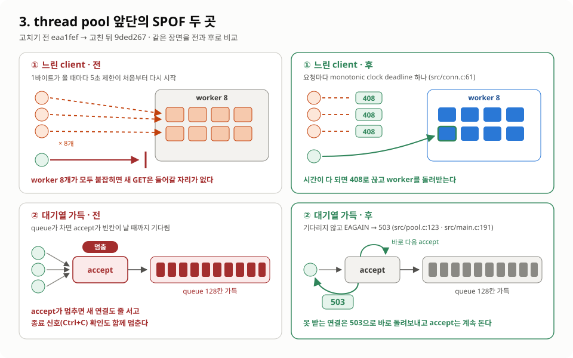

# C로 밑바닥부터 만든 웹서버 + 프록시

> **POSIX socket API만으로** 만든 HTTP/1.1 서버입니다. 정적 파일, CGI, **forward proxy와 reverse proxy(round-robin)**, thread pool, GET 캐시, event loop(`-e`)를 구현했습니다.
> 외부 HTTP·이벤트 라이브러리는 쓰지 않았습니다. `src/*.c` 15개 파일, 3,893줄입니다(2026-11-26 `main` 기준).

**발표 흐름:** 기능을 나열하지 않고, **서버가 지켜야 할 요구사항 → 그 요구사항으로 고른 동시성 모델 → 고른 모델 안의 SPOF 4곳 해결 → 남은 SPOF와 검증** 순서로 설명합니다.

| 장 | 내용 | 그림 |
|---|---|---|
| 1 | 서버가 지켜야 할 세 가지 | `story_01_requirements` |
| 2 | 같은 장면, 세 가지 모델 → thread pool 선택 | `story_02_concurrency_choice` |
| 3 | thread pool 앞단의 SPOF ①·② | `story_03_spof_input_queue` |
| 4 | 모두가 함께 쓰는 곳의 SPOF ③·④ | `story_04_spof_shared` |
| 5 | event loop, 남은 SPOF, 검증 | `story_05_evloop_summary` |

```sh
make && ./build/server -p 8080 -r ./www -w 8 -c routes.conf.example -f      # thread pool
./build/server -e                                                          # event loop 모드
```

---

## 1. 서버가 지켜야 할 세 가지


| 요구사항 | 뜻 |
|---|---|
| ① 느린 client | 한 연결이 느려도 다른 요청은 바로 처리된다 |
| ② 접속 폭주 | 연결이 몰려도 thread 수와 메모리에 상한이 있다 |
| ③ 공유 지점 | 로그 · 캐시 · 대기열처럼 모두가 쓰는 한 곳에서 줄 서지 않는다 |

이 세 장면이 깨지는 곳이 **SPOF(Single Point of Failure)**입니다. 모든 요청이 지나가는데 대신할 길이 없는 한 곳이며, 그곳이 막히면 thread를 늘려도 전체가 멈춥니다.

기능 요구사항(socket 흐름, HTTP 파싱, 정적 파일, CGI, proxy, 테스트)은 필수 16개를 모두 통과했습니다. 근거 파일은 맨 아래 부록에 있습니다.

---

## 2. 같은 장면, 세 가지 모델


느린 client 1개가 붙어 있을 때 새 GET 1개를 보낸 결과입니다(모델마다 1회 측정).

| 모델 | 새 GET 응답 | 요구사항 판정 |
|---|---:|---|
| 순차 처리 (기준선, 동시성 없음) | **4.5초** | ✕ ① 실패. thread가 하나라 느린 연결이 끝날 때까지 줄 선다 |
| 연결별 thread | **0.003초** | △ ① 통과, ② 실패. 연결 수만큼 thread가 늘어난다 |
| **thread pool (채택)** | **0.003초** | ✓ ①, ② 통과. worker 8 · queue 128로 상한이 고정된다 |

- 짧은 요청 처리량(`ab -n 2000 -c 50`, 4회 중앙값)은 순차 **25,428** · 연결별 **14,201** · thread pool **17,785** req/s로 순차가 가장 빠릅니다. thread를 만들고 바꾸는 비용이 없기 때문입니다.
- 그래서 처리량이 아니라 **1장의 요구사항으로** thread pool을 골랐습니다. 남은 문제는 고른 thread pool 안에서 모두가 기다리는 곳입니다.

---

## 3. thread pool 앞단의 SPOF 두 곳



| SPOF | 고치기 전 (`eaa1fef`) | 고친 뒤 (`9ded267`) |
|---|---|---|
| ① 느린 client와 worker | `recv()`마다 5초 제한이 다시 시작돼, 1바이트씩 보내는 연결이 worker를 계속 붙잡음. worker 8개가 다 잡히면 서버 전체가 응답 불가 | 요청마다 **monotonic clock deadline** 하나 (`src/conn.c:61`). 남은 시간만 기다리고 넘으면 **408** |
| ② accept와 worker 대기열 | queue 128칸이 차면 `pool_submit()`이 빈칸을 기다려 accept 반복이 멈춤. 새 연결도 종료 신호 확인도 함께 멈춤 | 기다리지 않고 `EAGAIN` (`src/pool.c:123`) → `main`이 **503**을 보내고 닫음 (`src/main.c:191`) |

---

## 4. 모두가 함께 쓰는 곳의 SPOF 두 곳


| SPOF | 고치기 전 (`eaa1fef`) | 고친 뒤 (`9ded267`) |
|---|---|---|
| ③ 로그 출력 | 모든 thread가 mutex 하나를 잡은 채 `write(stderr)`. 출력이 막히면 로그를 쓰려는 모든 thread가 멈춤 | **256 KiB ring buffer**에 넣고 전용 `log_writer` thread가 출력 (`src/log.c:13`, `:39`). 가득 차면 줄을 버리고 개수만 셈 (`:106`) |
| ④ 캐시 잠금 | 요청 전체를 `pthread_rwlock` 하나로 감쌈. 쓰기 잠금을 기다리는 POST 뒤로, 느린 GET이 끝날 때까지 모든 요청이 줄을 섬 | 요청 전체 잠금 제거. non-GET은 `cache_writers`와 generation만 올리고 (`src/cache.c:249`), 그동안 GET은 캐시를 건너뛰고 원본에서 응답 (`:401`) |

> 네 곳의 공통 원칙: **기다리지 않게 하거나, 기다림에 끝을 두거나, 실패를 빨리 돌려준다(408 · 503).**

---

## 5. event loop, 남은 SPOF, 검증


**keep-alive 문제:** thread pool만 쓰면 응답 뒤 쉬는 keep-alive 연결도 worker를 붙잡습니다. worker 8 · keep-alive 연결 100개(`ab -k -n 10000 -c 100`, 3회 중앙값)에서 **332 req/s, 실패 46~48건**이었습니다.

**event loop (`-e`):** loop thread 하나가 `kqueue`(macOS) 또는 `epoll`(Linux)로 쉬는 연결을 지켜보고, 요청이 다 온 연결만 worker에 넘깁니다. 응답 뒤 keep-alive 연결은 self-pipe로 다시 loop에 돌아갑니다.

| 항목 | thread pool | event loop (`-e`) |
|---|---|---|
| worker 8 · keep-alive 100 | 332 req/s, 실패 46~48건 | **64,656 req/s, 실패 0건** |
| 쉬는 연결 N개 + 새 GET | 200개 중 136개만 응답, 새 GET은 503 | 200개 · 1,000개 모두 응답, 새 GET 0.6~0.8 ms |

**남은 SPOF (범위 밖으로 기록)**

| SPOF | 지금의 대응 · 한계 |
|---|---|
| 서버 process 1개 | crash 하나에 모든 연결이 끊김. 여러 process · 여러 서버로 나누는 구조는 범위 밖 |
| loop thread 1개 (`-e`) | loop는 Blocking 호출을 하지 않음. 요청 처리는 worker가 맡음 |
| reverse proxy 자신 | 백엔드 하나가 죽으면 round-robin으로 다음 백엔드로 넘어감. proxy 이중화는 범위 밖 |
| 짧게 잡는 공유 lock | 캐시 목록 · round-robin mutex는 목록을 고치는 짧은 구간만 잡음 |

**검증 (2026-11-26, 로컬)**

| 검사 | 결과 |
|---|---|
| 단위 테스트 (`make test`, `make test-asan`) | 4개 스위트 통과 |
| 기능 테스트 (`./scripts/functional_test.sh`) | **24/24**, event loop 모드 **25/25** |
| ASan + UBSan · TSan | 두 모드 모두 보고 0건 |
| SPOF 수정 확인 | 같은 검사를 고치기 전 코드(`eaa1fef`)에 돌리면 ① 느린 헤더 → 408, ④ 느린 GET 중 POST · GET 즉시 처리, 두 검사가 실패. 지금은 통과 |

> 측정은 모두 같은 Mac의 loopback에서 `-O0` debug build로 했고 실행마다 흔들립니다. 원본 출력은 [`docs/benchmarks/`](../docs/benchmarks/)에 있습니다. Linux `epoll` 경로는 형식 검사만 했고 실행하지 못했습니다.

**결론:** 모델을 고르는 것으로 끝나지 않습니다. 고른 모델 안에서 모두가 기다리는 곳을 찾아 없애야 서버가 끝까지 버팁니다.

---

<details>
<summary>부록: 과제 필수 요구사항 검수 (근거 파일)</summary>

| 요구사항 | 판정 | 근거 |
|---|:-:|---|
| socket→bind→listen→accept | ✅ | `src/net.c` `net_listen()`, `src/main.c` accept 루프 |
| 요청 라인 · 헤더 · 본문 파싱, GET/POST | ✅ | `src/http.c` `http_parse()`, `src/conn.c` 본문 수신 |
| 상태 라인 + Content-Type/Length/Connection | ✅ | `src/response.c` `resp_format_head()` |
| 정적 파일 · MIME · 403/404/500 | ✅ | `src/static.c` (realpath로 루트 이탈 방지), `src/mime.c` |
| 동적 처리 (CGI 또는 백엔드 전달) | ✅ | `src/cgi.c` fork/execve/pipe, `src/proxy.c` |
| 동시 처리 (fork / pthread / I/O 멀티플렉싱 중 1개 이상) | ✅ | `src/pool.c` thread pool(채택), 연결별 thread 브랜치, CGI는 `fork()`, `kqueue`/`epoll` event loop(`-e`). 순차 브랜치는 비교 기준선 |
| forward 또는 reverse proxy (1개 이상) | ✅ | 둘 다: `proxy_forward_cached()`, `proxy_reverse_cached()` + round-robin `route_pick()` |
| 라우팅: 경로 또는 Host 기반 | ✅ | `src/route.c` `route_match()` (둘 다) |
| CLI 인자 또는 설정 파일 | ✅ | `src/config.c` getopt, `routes.conf` |
| Makefile | ✅ | `all / test / asan / tsan / test-asan` |
| SIGINT/SIGTERM 안전 종료, SIGPIPE 무시 | ✅ | `src/main.c` sigaction + `pool_shutdown()` |
| 금지 라이브러리 미사용 | ✅ | 표준 C, POSIX, pthread만 사용 |
| 단위 테스트 | ✅ | `tests/test_http.c`, `test_mime.c`, `test_route.c`, `test_conn_event.c` |
| 기능 테스트 (curl, 동시 접속) | ✅ | 24/24 (event loop 모드 25/25) |
| 부하 테스트 | ✅ | `ab`, [`docs/benchmarks/`](../docs/benchmarks/) |
| 메모리 검사 (sanitizer 또는 valgrind) | ✅ | ASan+UBSan 오류 0, TSan 경고 0 |
| 엣지 케이스 | ✅ | 400/413/414/431/501/505, 502/504, 408(느린 헤더), 503(대기열 가득), client 중도 종료 |
| 이식성 고려 | △ | `#ifdef SO_NOSIGPIPE`, `kqueue`/`epoll` 분기. Linux 빌드는 실행하지 않음 |

</details>
